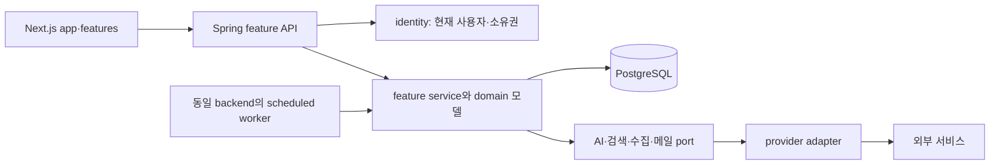

# System architecture

[도메인 개요](domain.md)는 제품 흐름과 모델의 의미를, 이 문서는 실행 단위·패키지 책임·의존 방향·데이터와 외부 호출 경계를 설명한다. [도메인 상세](domain.md#도메인-지도)와 [UI 화면 모음](ui/README.md)을 함께 참고한다.

## 현재 구조

```text
Browser
  → Next.js (UI, same-origin API/OIDC proxy)
    → Spring Boot BFF (Auth0 OIDC client, CSRF, authorization)
      → Auth0 Universal Login (Google + email OTP)
      → PostgreSQL (user ownership + JDBC session + domain data)
      → Firecrawl API (public URL scrape/search, optional, explicit consent)
      → Serper API (product-name lookup / condition discovery, explicit consent)
      → Gemini Developer API (dogfooding default, optional, explicit consent)
      → OpenAI API (optional alternative)
      → Resend API (outcome reminder email, optional)
```

단일 backend 배포 단위 안에서 아래 feature package를 사용한다. message broker, cache, vector database, microservice는 도입하지 않는다. 문서의 도메인 구분과 Java package는 일대일 대응하지 않는다. 예를 들어 `guidance`는 카탈로그·추천·근거를 함께 구현하며, 회고는 `decision`, 알림은 `notification`, 성향은 `preference`에 나뉘어 있다.

## 코드 구성과 의존 방향

| backend package | 현재 책임과 주요 연결 |
|---|---|
| `decision` | aggregate·비교·이유·완료·구매·재검토/취소·회고·보관/삭제 API를 조정한다. DecisionMemoryController는 같은 제품군의 과거 기록을 읽고 MemoryInsightService는 선택적 AI 해석의 입력 고정·생성·재사용·수명을 관리한다. template·guidance·evaluation·preference·notification 모델과 협력하며 `DecisionTaskWriter`로 외부 작업 결과 쓰기를 보호한다. |
| `template` | 제품군별 versioned 초기 기준·조건과 intake 선택지를 제공한다. |
| `evaluation` | 입력 준비·snapshot·순수 Java 점수 계산·평가 이력을 담당한다. 선택적 AI 평가는 ai port를 사용한다. |
| `ai` | 구조화 proposal·AI 정책·provider port/adapter·실행 metadata를 관리한다. 외부 호출 결과는 보호된 결과 쓰기로 저장한다. |
| `guidance` | 공유 카탈로그 등록·갱신, 조건 탐색, 후보·근거·질문, 사양·호환성 판정과 worker를 담당한다. |
| `lookup` | 동기 제품명 검색과 Serper adapter·durable 검색 한도를 담당한다. guidance의 검색 port를 구현하며 실시간 탐색과 한도를 공유한다. |
| `identity` | Auth0 로그인·세션·CSRF·사용자 provision·현재 내부 사용자 해석을 담당한다. 개인 API는 이 사용자로 소유권을 제한한다. |
| `notification` | 회고 알림 설정·상태·scheduled email worker·Resend adapter를 담당한다. Decision 소유권과 현재 Resolution을 확인한다. |
| `preference` | 성향 기억의 사용자 확인·수정·제외·삭제와 원본 수명에 따른 적용 가능 조회를 담당한다. |
| `secrets` | backend 초기 설정 시 환경 identity로 Secret Manager 값을 읽는다. domain 데이터 저장소나 frontend API가 아니다. |
| `common` | HTTP 오류 변환과 작은 공통 예외를 제공한다. |

frontend의 `app/`은 route·server composition, `features/`는 사용자 흐름, `shared/api/`는 generated OpenAPI 타입과 얇은 client다. 브라우저는 같은 origin의 Next.js `/api` rewrite를 통해 Spring에 접근한다. `/oauth2`, `/login/oauth2`, `/logout`도 backend로 전달하며 인증 token을 frontend에 복제하지 않는다.



이는 주요 실행 방향이며 package 간 의존을 정적으로 강제하는 모듈 경계도는 아니다. controller·service·entity·repository는 feature 안에 가까이 두며 별도 배포 단위나 최상위 layer module을 추가하지 않는다.

## 대표 요청과 비동기 실행

| 과정 | 실행 흐름과 보존 경계 |
|---|---|
| 카탈로그 추천 | UI → Decision 생성 → DB CatalogProduct 조회 → 개인 CandidateSuggestion 복사. 추천 요청 중 외부 호출은 없다. |
| 후보 승인·조건 비교 | 사용자가 후보를 Option에 연결 → 현재 comparison_state 저장 → 판정 표시. 수집 사양·사용자 확인·평가 입력을 구분한다. |
| 평가·완료 | 최신 version 검증 → Evaluation 입력·결과 고정 → 선택적으로 독립 LLM 평가. 완료는 별도로 Resolution의 comparison_snapshot을 고정한다. |
| 완료·구매·재검토 | 이유 ID·대표 이유·자유 메모를 Resolution에 기록하고 선택·보류·포기를 모두 완료한다. 구매 상태는 별도 갱신하며 미구매 확인 후 재개·임시 draft/후보 선택 복원본으로 취소한다. |
| 원문 기록 활용 | DecisionMemoryController가 소유자·같은 제품군·유효 기록 최대 3개와 각 회고 2개를 DB에서 조회한다. 사용자 선택 시 출처 ID를 포함한 현재 Context 메모에 저장하며 외부 호출·weight 변경은 없다. |
| 선택적 기록 AI 해석 | MemoryInsightController GET으로 입력·hash·고지를 확인 → 명시적 동의 POST → 입력 snapshot commit → 기존 AI adapter 호출 → 두 부모 잠금·자격/hash 재확인 후 결과 저장. 동일 입력 결과는 재사용한다. |
| 회고·개인화 | 선택적 회고 → PROPOSED 성향 → 사용자 확인 → 같은 제품군의 새 Decision 기본값. 원문 기록 활용과 별도다. 새 완료의 자동 알림은 없다. |
| 기존 실시간 탐색·근거 | 상태 행 생성 → scheduled worker claim → 외부 검색·수집·AI → 실행 식별자·version·부모 존재/삭제 재확인 후 결과 저장. |
| 운영 갱신·알림·삭제 | 카탈로그 고정 URL 예약 갱신, 회고 email 발송, 휴지통 만료 purge를 같은 backend의 scheduler가 수행한다. |

모든 worker의 transaction 경계가 같은 것은 아니다. 탐색·카탈로그 갱신은 예약/claim과 외부 호출·결과 쓰기를 분리한다. 알림은 부모 잠금과 현재 Resolution 확인으로 정정·삭제와 발송 순서를 보장한다. 이미 외부 전송된 요청·메일까지 취소할 수 있다는 뜻은 아니다.

## 데이터 경계

웹 페이지 수집은 `WebEvidenceProvider`, 검색은 `WebSearchProvider`로 분리한다. Firecrawl adapter는 두 port를, Serper adapter는 검색 port만 구현한다. 기존 guided intake의 자동 대안 검색은 Firecrawl에 고정하며 제품명 lookup 설정이 기존 동의의 전송 대상을 바꾸지 않는다. 제품명 lookup은 인증·CSRF·별도 동의 후 동기 실행한다. 사용자 선택 전에는 Decision/Option/Evidence를 만들지 않는다. 선택 후 기존 create/addSource API와 비동기 evidence worker를 사용한다.

V7은 익명 월별 검색 호출 수만 보존한다. PostgreSQL atomic upsert를 독립 transaction에서 commit한 뒤 외부 호출한다. timeout도 사용량을 소비하며 자동 재시도·환불은 없다. 월 1,000회 이하의 durable cap과 단일 instance의 사용자별 5회/분·동시 2건 제한을 적용한다. query/result는 서버에 저장하지 않으며 로그와 metric label에도 넣지 않는다. 자세한 운영 경계는 [배포 runbook](deployment.md), 결정 이유는 [ADR 0007](decisions/0007-final-mvp-product-lookup.md)을 따른다.

- Decision aggregate: 사용자가 계속 수정하는 current state. Option, Criterion, value, Constraint를 관계형 table로 저장한다.
- Evaluation: 특정 `decisionVersion`의 immutable input snapshot, hash, algorithm result, optional LLM result를 저장한다.
- StructureRun: LLM에 실제 전달한 input과 proposal, 실행 metadata를 저장한다. proposal은 Decision을 자동 변경하지 않는다.
- 구조화 AI에는 현재 활성 비교 기준의 이름·타입·단위를 전달한다. 기존 `StructureRun` input snapshot에 기준 목록이 없어도 읽을 수 있으며 과거 snapshot을 재작성하지 않는다.
- Resolution/OutcomeCheckIn: 제품 선택·보류·포기와 선택적 회고를 append한다. Resolution은 reasonIds·primaryReasonId·rationale와 별도 purchaseStatus를 갖는다. PURCHASED 이후 구매 상태 변경·재검토를 차단한다.
- 재검토 임시 복원본: Decision.revisionDraft와 revisionCandidates JSONB에 시작 전 draft 및 후보 수락·제외·Option 연결을 보존한다. 취소는 이전 결론을 복원하고, 완료·취소는 임시 복원본을 해제한다. 과거 고정본·추천 실행·수집 자료 전체를 되돌리지 않는다.
- 과거 원문 기록 Memory: 별도 aggregate나 학습 저장소가 아닌 조회 projection이다. 삭제·활용 제외·정정된 기록 및 정정 중 원본을 제외한다. 출처가 있는 현재 메모와 기존 PreferenceMemory를 구분한다. 선택적 MemoryInsight의 입력에는 현재 Context.notes를 넣지 않는다.
- MemoryInsightInput/MemoryInsight: 실제 동의 입력 snapshot과 AI 결과를 현재 Decision·원본 Decision·원본 Resolution에 연결한다. hash·provider/model·prompt/schema·지연·token metadata를 보존하며 부모의 영구 삭제 시 cascade한다. 호출 중에는 잠금 없이 실행하고 저장 직전 두 부모를 ID 순으로 잠가 자격·입력 변경을 재확인한다. 자세한 수명은 [기록 활용](domains/history-reuse.md)을 따른다.

## 클릭 추천 작업

기본 `catalog-v1` 추천은 같은 transaction에서 공유 `CatalogProduct`의 공개 사양·판매 관측을 읽고 개인 `CandidateSuggestion`에 복사한다. 추천 요청의 검색·수집·LLM 호출은 없다. 초기 5개·최대 30개이며 PostgreSQL이 원본이므로 별도 캐시는 두지 않는다. 제품 등록은 검토한 로컬 manifest의 revision으로 갱신한다.

가격 worker는 사용자가 아닌 운영자가 등록한 고정 URL만 Firecrawl에 전달한다. 사용자 조건·메모는 전달하지 않는다. V11의 제품별 다음 시도 시각, UTC 월별 호출 예약, 관측 이력을 별도 transaction에서 저장한 뒤 외부 호출하며 중단·실패도 한도를 소비한다. `FOR UPDATE SKIP LOCKED`와 atomic quota upsert로 중복 호출을 제한한다. 가격 48시간 갱신·72시간 유효와 사양 30/90일 정책과 과거 snapshot 보존은 [ADR 0016](decisions/0016-curated-catalog.md), 설정은 [운영 문서](catalog-operations.md)를 따른다.

아래는 기존 `intake-v1/v2` 실시간 추천의 호환 경로다.

`ProductDiscovery`는 기존 모놀리스의 scheduled worker에서 처리한다. 소유권과 명시적 동의를 확인한 Decision만 시작하며, `FOR UPDATE SKIP LOCKED`로 claim한 뒤 외부 호출을 transaction 밖에서 실행한다. 상태와 version으로 중복 실행·늦은 완료를 제어하고 실패는 수동 재시도한다. 최초 검색 1회·페이지 최대 5개·AI 1회로 제한하며 Serper quota는 제품명 lookup과 공유한다. 표시용 사양은 CandidateSuggestion에 저장하고 승인 시 Option과 연결한다. 평가값과 과거 snapshot을 변경하지 않는다. [ADR 0009](decisions/0009-click-first-product-discovery.md)에 동의·저장·실패 경계를 기록한다.

## 요청 흐름

같은 후보의 비교 조건과 직접 확인은 Decision의 JSONB `comparison_state`에 저장한다. Resolution 생성 시 현재 조건·판정·근거를 JSONB `comparison_snapshot`에 복사한다. 조회는 과거 snapshot을 현재 카탈로그나 matcher로 재계산하지 않는다. 최초 추천 이력·평가 snapshot과의 경계는 [ADR 0017](decisions/0017-comparison-and-resolution-context.md)에 기록한다.

1. 사용자가 versioned template로 Decision을 만든다.
2. draft 저장은 expected version을 검사한다.
3. 평가 시 완전성과 constraint 상태를 검증하고 immutable snapshot을 만든다.
4. algorithm은 동기적으로 항상 먼저 실행한다.
5. 동의한 경우에만 LLM이 같은 snapshot을 독립 평가한다. 장애 시 algorithm result는 남는다.

## 배포 준비와 데이터 삭제

단일 GCP VM의 HTTPS proxy·Next.js·Spring Boot·PostgreSQL 구성과 VM attached Identity를 준비한다. 컨테이너는 별도 IAM identity 경계가 아니며 actual provisioning은 수행하지 않았다. [ADR 0019](decisions/0019-portfolio-deployment-preparation.md)를 따른다. Cloud Run(Next.js ingress + Spring Boot sidecar)과 Neon PostgreSQL로의 전환이 [ADR 0025](decisions/0025-cloud-run-neon-deployment.md)로 결정되었으며, 전환 완료 전까지는 단일 VM 구성이 운영 기준이다.

완료 의미와 이유·구매·재검토는 [ADR 0022](decisions/0022-decision-reasons-and-reusable-history.md), 선택적 AI 기록 해석은 [ADR 0023](decisions/0023-contextual-decision-memory.md)를 따른다. 별도 module·배포 단위·AI provider를 추가하지 않는다.

기본 목록은 DTO projection과 DB pagination으로 소유자별 상태 결과 중 보관·삭제되지 않은 결정을 조회한다. 진행 상태와 기록 수명을 분리해 보관과 30일 휴지통 복구를 제공한다. 삭제·복구는 부모 행 잠금·version 확인으로 직렬화하며 만료 후 영구 삭제에 DB cascade를 사용한다. 성향 기억의 source FK도 cascade이며 활용 조회는 원본의 삭제·개인화 설정을 검사한다. 외부 작업 완료는 부모의 존재와 삭제 여부를 다시 확인한다. 기록 AI 해석은 현재·원본 두 부모와 최근 기록 자격·inputHash를 조회·전송·저장 경계에서 재확인한다. 알림·evidence worker는 삭제와 동일한 부모 잠금 순서를 사용한다. 새 완료는 자동 알림을 만들지 않으며 기존 예약만 기존 발송 경계로 관리한다. commit 후 최소 상태 변경 audit를 남겨 백업 복원 시 재적용한다. [ADR 0020](decisions/0020-decision-retention-and-personalization.md)을 따른다.

## Security/operations baseline

- Spring이 OIDC Authorization Code + PKCE와 server-side session을 소유한다. 브라우저에는 `HttpOnly`, `Secure`, `SameSite=Lax` session cookie만 두고 access token을 노출하지 않는다.
- Session은 PostgreSQL에 저장하고 7일 비활성 만료한다. 변경 요청은 same-origin CSRF cookie/header를 검증하며 CORS를 열지 않는다.
- Auth0의 verified email이 exact allowlist에 있을 때만 로컬 사용자를 provision한다. 동일 이메일의 다른 identity는 자동 연결하지 않는다.
- 로그인 실패 후에는 서버 session의 재인증 표시가 남아 있는 동안 authorization request에 `prompt=login`을 붙여 Auth0 로그인 화면을 다시 요구한다. 표시는 로그인 성공 시 지우며 첫 로그인은 기존과 같다. 운영 tenant에서의 효과는 검증하지 않았으며 한계는 [사용자·소유권](domains/identity.md#로그인과-접근의-생명주기)을 따른다.
- 모든 사용자 resource 조회는 현재 local user UUID로 scope한다. Decision 하위 데이터는 Decision ownership을 상속하며 타인 resource는 `404`로 응답한다.
- `local` profile만 고정 개발 사용자를 제공하고 loopback에 bind한다. 기본/production 실행에는 인증 우회가 없다.
- source URL은 공개 HTTP(S)만 허용하고 managed provider adapter에 전달한다. 인증 정보, cookie, screenshot, private/local host는 허용하지 않으며 원문 전체는 DB에 저장하지 않는다.
- AI request storage는 provider 설정에서 끄고 timeout/retry를 제한한다. Gemini 무료 티어 dogfooding에는 저민감 구매 정보만 허용하며, 서버와 UI가 민감 정보 비포함 확인을 요구한다.
- evidence import와 reminder는 PostgreSQL status row를 scheduled worker가 처리한다. broker를 추가하지 않고 실패·재시작 후 수동 retry와 idempotent email 전송을 지원한다.
- Actuator는 health/info만 노출한다. 실제 Secret은 backend 초기 설정 단계에서 GCP Secret Manager를 직접 조회해 JVM 메모리에 바인딩한다. local은 Developer ADC로 Dev 프로젝트, 운영은 서비스 Identity로 Prod 프로젝트만 접근한다. 평문 파일/환경 변수 fallback과 일반 CI의 Secret 접근은 없다. 비밀 아닌 설정은 기존 YAML/환경 변수를 사용한다. 상세 전략은 [ADR 0008](decisions/0008-identity-based-secret-management.md), 절차는 [runbook](deployment.md#secret-management)을 따른다.

관련 결정은 [ADR 목록](decisions/)을 참고한다.
