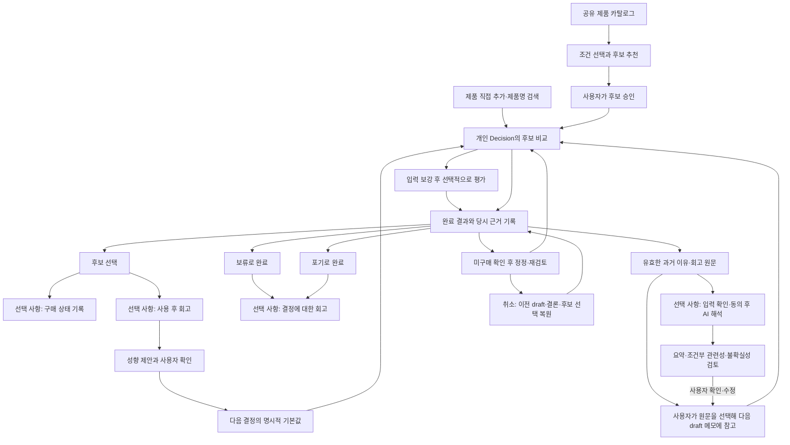
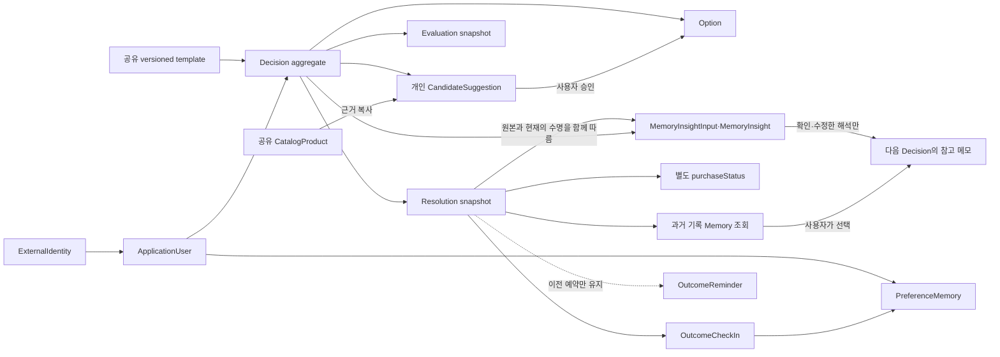

# 도메인 개요

Decision Assistant는 구매 후보의 근거를 확인하고 비교한 뒤, 선택 이유와 사후 회고를 다음 결정에 연결한다. 객관적 사양, 사용자의 예상 만족도, 실제 결정과 사후 결과를 구분해 보존한다. 완료·구매·재검토는 [ADR 0022](decisions/0022-decision-reasons-and-reusable-history.md), 선택적 기록 AI 해석은 [ADR 0023](decisions/0023-contextual-decision-memory.md)를 따른다.

이 문서는 전체 흐름과 공통 경계를 설명한다. 모델·관계·생명주기는 아래 상세 문서, 준수할 동작은 [Business rules](business-rules.md), 설계 선택의 이유는 [ADR](decisions/), 실행 구조는 [Architecture](architecture.md)에서 관리한다. [UI 화면 모음](ui/README.md)에서 각 과정의 화면을 볼 수 있다.

## 전체 흐름

기본 추천은 등록된 이어폰 카탈로그를 읽으며 요청 시 검색·수집·AI를 호출하지 않는다. 기존 실시간 탐색과 제품명 검색은 별도 동의가 필요한 경로다. 추천 후보 0개에서 시작할 수 있고 비교·결정 완료에 점수 평가는 필수가 아니다. 제품 선택·보류·포기는 모두 완료이며 필수 흐름은 여기서 끝난다. 구매 상태 기록·회고는 선택 사항이고 신규 자동 알림은 만들지 않는다. 선택만으로 구매나 만족을 추정하지 않는다.

## 도메인 지도

| 영역과 상세 문서 | 책임 | 주요 모델 |
|---|---|---|
| [제품 카탈로그](domains/catalog.md) | 공유 제품 identity·사양·판매 관측과 정보 수명 | CatalogProduct, Fact, OfficialOffer |
| [제품 탐색·근거](domains/discovery-evidence.md) | 추천 실행, 후보 승인, 공개 근거 수집·확인 | ProductDiscovery, CandidateSuggestion, EvidenceImport, DecisionQuestion |
| [결정·비교](domains/decision-comparison.md) | 개인 비교 입력, 구조화된 이유·별도 구매 상태, 완료·재검토·기록 수명 | Decision, Option, Criterion, Constraint, Comparison, Resolution |
| [평가](domains/evaluation.md) | 재현 가능한 점수 평가와 독립 AI 평가 | DecisionSnapshot, Evaluation, AlgorithmResult, StructureRun |
| [회고·알림·개인화](domains/outcome-personalization.md) | 완료 결과의 회고, 알림, 확인 가능한 성향 기억 | OutcomeCheckIn, OutcomeReminder, PreferenceMemory |
| [과거 판단 기록 활용](domains/history-reuse.md) | 같은 제품군 원문 또는 동의한 AI 해석을 명시적으로 참고 | Memory 조회 projection, MemoryInsightInput, MemoryInsight |
| [사용자·소유권](domains/identity.md) | 외부 identity와 내부 사용자 연결, 데이터 접근 경계 | ApplicationUser, ExternalIdentity |

템플릿은 결정의 초기 기준·조건을 만들고 평가의 해석 기준을 제공하므로 [결정·비교 문서](domains/decision-comparison.md#템플릿과-초기값)에서 설명한다. 도메인별 문서 구분은 별도 서비스나 배포 단위를 뜻하지 않는다.

## 핵심 관계와 소유권

Decision은 수정 가능한 aggregate root로 Context, Option, Criterion, OptionValue, Constraint, ConstraintResult를 소유한다. Context는 목적·예산·메모를 담은 value다. 평가·추천·구조화·완료·회고·알림은 decisionId를 통해 Decision 소유권을 따른다. PreferenceMemory는 사용자 소유이며 원본 Decision과 Outcome을 참조한다. 공유 카탈로그와 템플릿에는 개인 Decision의 소유권을 적용하지 않는다.

## 공통 불변 조건과 시간 경계

- **사양과 평가값:** 출처가 있는 ProductFact와 평가용 OptionValue는 다르다. 자동 수집 사양의 UNREVIEWED는 사용자 확인 사실이 아니다. RequirementCheck의 MEETS/BELOW/UNKNOWN도 평가의 필수 조건 통과·탈락과 다르다.
- **현재 입력과 과거 기록:** Decision은 version으로 동시 수정을 검사한다. Evaluation은 당시 입력·알고리즘 결과를, Resolution은 당시 비교 조건·근거·판정을 고정한다. 카탈로그 갱신·가격 만료·재검토로 과거 기록을 다시 계산하지 않는다.
- **사용자 확인과 자동 제안:** USER 또는 CONFIRMED 값은 background import나 AI proposal이 덮어쓰지 않는다. AI와 결정론적 평가를 임의의 한 점수로 합치지 않는다.
- **완료와 구매:** DRAFT만 직접 편집한다. CHOSEN·DEFERRED·ABANDONED는 모두 phase=COMPLETED다. result는 기존 호환 값이며 DEFERRED에서는 null이다. 선택 기록의 purchaseStatus는 별도이고 UNRECORDED는 미구매 증명이 아니다. PURCHASED 이후 구매 상태 변경·정정·재검토는 막는다.
- **재개와 취소:** 미구매 명시 확인과 최신 version으로 정정·재검토한다. 정정은 이전 완료 기록을 대체하고 재검토는 이전 판단을 유효하게 남긴다. 취소는 임시 복원본으로 이전 draft·결론·후보 수락/제외 연결을 복원한다. 회고는 대상 Resolution에 연결하며 과거 고정본을 바꾸지 않는다.
- **기록 활용과 성향:** 원문 참고와 선택적 MemoryInsight는 출처가 있는 현재 메모에만 추가한다. AI 해석은 실제 전송 입력 확인·동의와 snapshot 보존을 거치며 원본 또는 입력 변경 시 재검증한다. 현재 메모는 AI 해석 입력에서 제외한다. 기존 PreferenceMemory의 별도 확인·기본 weight 적용과 구분하고 해석을 고정 성향·사양·가중치로 자동 변환하지 않는다.
- **진행 상태와 기록 수명:** archivedAt, deletedAt, personalizationEnabled는 진행 상태와 별개다. 보관은 목록 정리, 삭제는 30일 복구 유예 후 연쇄 영구 삭제다. 기존 ARCHIVED enum과 새 보관 기능을 혼동하지 않는다.
- **소유권과 외부 전송:** 개인 resource는 소유자만 접근한다. URL 문자열은 자동 fetch 지시가 아니며 사용자 경로의 검색·수집·AI는 해당 동의와 공개 URL 검증을 거친다. 운영자 등록 고정 URL 갱신은 별도 경계다.

## 문서를 읽고 변경하는 순서

신규 개발자는 전체 흐름 → 담당 도메인 상세 → 관련 BR-* 규칙 → 코드·테스트 순서로 읽는다. 상세 문서는 의미 있는 속성과 관계·상태 전이를 설명하며 DB의 모든 열이나 API 필드를 복제하지 않는다. API 필드는 [OpenAPI](api/openapi.json), schema는 [Flyway migration](../backend/src/main/resources/db/migration/)을 확인한다.

동작 변경 시 상세 문서와 관련 규칙·검증을 함께 갱신하고 장기 설계 변경 이유는 ADR에 남긴다. 아직 결정되지 않은 정책은 [미정 동작](business-rules.md#아직-정하지-않은-동작)으로 구분하며 문서화 과정에서 새 정책으로 확정하지 않는다.
