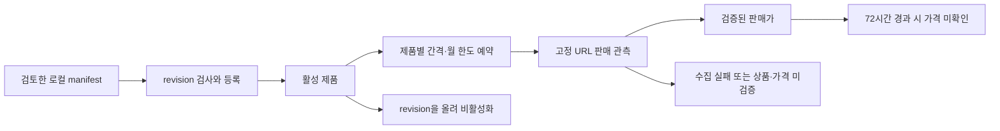

# 제품 카탈로그

[전체 흐름](../domain.md) · [화면 모음](../ui/README.md)

## 책임과 범위

운영자가 검토한 공개 제품·공식 사양·판매 관측을 공유 데이터로 관리한다. 기본 추천 대상은 이어폰이며 사용자 조건·메모를 카탈로그에 저장하지 않는다. 상품별 검증 방식과 실행 설정은 [카탈로그 운영](../catalog-operations.md), 판매처 인정 범위는 [공식 판매처](../official-stores.md)를 따른다.

## 모델과 관계

| 모델·속성 | 의미와 관계 |
|---|---|
| `CatalogProduct.id`, `expectedIdentity` | 등록 항목과 실제 모델·구성을 식별한다. 비슷한 이름만으로 다른 모델의 사양을 합치지 않는다. |
| `revision`, `version` | revision은 등록 내용의 개정 번호, version은 DB 동시 수정 제어다. |
| `brandName`, `brandStatus` | 관리용 대표 이름과 확인 상태다. KNOWN은 실제 이름이 필수이고 UNBRANDED·UNVERIFIED는 NULL이다. |
| `Fact` → `ProductFact` | 값·출처 URL·짧은 인용·확인 시각·확인 상태와 HARDWARE/SOFTWARE 점검 주기를 묶는다. |
| `factReviews` | 같은 revision의 사양을 다시 확인한 시각이다. 단순 문구 발견으로 정확성을 확정하지 않는다. |
| `OfficialOffer`, `priceStatus` | 판매 URL·판매처·KRW 가격·관측 시각과 검증 상태다. 상품 검증 실패는 통신 실패와 구분한다. |
| 관측·사용량 기록 | `catalog_observations`는 시도 결과, `catalog_monthly_usage`는 UTC 월 호출 예약을 보존한다. 개인 조건은 포함하지 않는다. |

공유 CatalogProduct에서 추천 시점의 사양·판매 근거를 개인 CandidateSuggestion으로 복사한다. 사용자 승인 후 Option과 연결되며, 이후 공용 갱신이 개인 입력이나 과거 Evaluation·Resolution을 바꾸지 않는다. [탐색·근거](discovery-evidence.md)에서 승인 이후를 설명한다.

## 생명주기

| 변화 | 현재 동작 |
|---|---|
| 최초 등록 | 사양은 등록하지만 과거 가격을 최신 판매가로 seed하지 않는다. |
| 등록 수정 | revision 증가가 필요하다. 같은 revision의 내용 변경은 거절하고 낮은 revision은 최신 등록을 되돌리지 않는다. |
| URL·identity 변경 | 기존 판매가를 무효화하되 마지막 시도의 다음 예약 시각은 유지한다. |
| 가격 갱신 | 제품별 48시간 간격, 유효기간 72시간이다. 요청 전 월 한도를 예약하고 실패·중단도 소비한다. |
| 수집 실패 | 기존 관측 시각을 연장하지 않는다. 상품·가격 검증 실패는 새 추천의 판매 정보를 제외한다. |
| 사양 재점검 | SOFTWARE는 30일 이후 새 추천에서 제외한다. HARDWARE의 90일은 재점검 기한이며 사실의 자동 소멸을 뜻하지 않는다. |
| 비활성화 | 항목을 삭제하는 대신 `active:false`와 revision 증가로 새 추천에서 제외한다. |

## 불변 조건과 다른 도메인의 경계

등록 사양의 UNREVIEWED와 사용자 확인을 구분한다. ANC 지원 여부는 ANC 만족도 점수가 아니며 앱 지원 OS와 기본 음악·통화 호환성을 동일하게 취급하지 않는다. 판매가 검증은 해당 모델·구성·조건에만 적용한다. 조건부 가격·불명확한 구성이나 UNKNOWN을 임의로 확정하지 않는다.

카탈로그 갱신은 운영자가 등록한 고정 공개 URL을 사용하며 사용자 조건을 외부로 보내지 않는다. 기본 추천 요청은 DB를 읽으며 검색·수집·AI를 호출하지 않는다. 공유 카탈로그는 개인 Decision 삭제로 제거되지 않는다.

## 규칙·구현·검증

- 규칙: [BR-CAT-01-04, BR-DISC-04](../business-rules.md), [ADR 0016](../decisions/0016-curated-catalog.md).
- 구현: [CatalogProduct](../../backend/src/main/java/com/decisionassistant/guidance/CatalogProduct.java), [CatalogImporter](../../backend/src/main/java/com/decisionassistant/guidance/CatalogImporter.java), [CatalogDiscovery](../../backend/src/main/java/com/decisionassistant/guidance/CatalogDiscovery.java), [CatalogRefreshWorker](../../backend/src/main/java/com/decisionassistant/guidance/CatalogRefreshWorker.java).
- 검증: `CatalogApiIntegrationTest`, `frontend/e2e/catalog.spec.ts`, [실측 기록](../evaluations/). 테스트 위치는 저장소에서 식별자로 검색할 수 있다.
