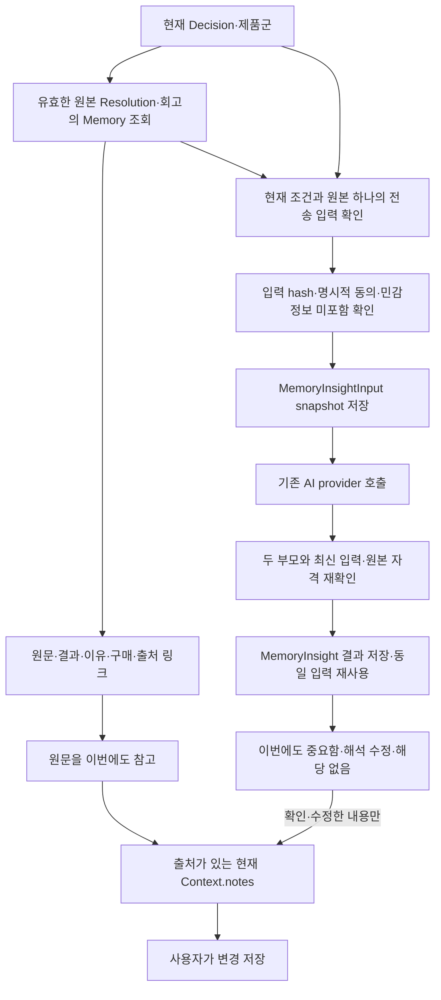

# 과거 판단 기록 활용

[전체 흐름](../domain.md) · [결정·비교](decision-comparison.md) · [회고·성향 기억](outcome-personalization.md) · [화면 모음](../ui/README.md)

## 책임과 범위

같은 제품군의 과거 판단 이유와 이후 회고를 원문으로 보여 주고, 사용자가 원하면 한 기록의 AI 요약과 현재 조건에 따른 참고 설명을 제공한다. 원문 참조는 [ADR 0022](../decisions/0022-decision-reasons-and-reusable-history.md), 선택적인 AI 해석은 [ADR 0023](../decisions/0023-contextual-decision-memory.md)을 따른다. 완료에 필수 단계를 추가하거나 과거 선택을 고정 성향·검증된 제품 사양으로 자동 변환하지 않는다.

## 모델과 관계

| 모델·정보 | 의미와 관계 |
|---|---|
| DecisionMemoryController.Memory | 새 entity가 아닌 조회 projection이다. 원본 decisionId/resolutionId·제목·결과·선택 제품·이유·메모·구매 상태·당시 Context/비교 조건·최근 회고를 묶는다. |
| 과거 Resolution / OutcomeData | 같은 소유자·제품군에서 현재 결정 이외 최근 유효 Resolution 최대 3개와 각 회고 최대 2개다. 같은 Decision의 여러 유효 판단이 포함될 수 있다. |
| MemoryInsightContracts.Input / InsightView | 실제 전송 항목과 이유 label, inputHash, provider/model·고지·사용 가능 여부·동일 입력의 저장 결과를 제공한다. |
| MemoryInsightInput | 외부 호출 전에 동의한 실제 입력을 JSONB snapshot으로 고정한다. 현재 decisionId·sourceDecisionId·resolutionId·hash·생성 시각을 보존한다. |
| MemoryInsight | 같은 세 원본 참조와 inputId·inputHash, 결과·provider/model·prompt/schema version·지연·token 수·생성 시각을 저장한다. 여러 기록을 합친 성향 모델이 아니다. |
| 현재 Context.notes | 원문 또는 확인·수정한 AI 해석을 출처 ID와 함께 복사하는 사용자 입력이다. 서버에 보존하려면 기존 변경 저장을 수행한다. |

과거 제품명·당시 조건은 Resolution snapshot에서 읽는다. 제목도 snapshot이 있으면 그 제목을 사용하고 snapshot 자체가 없는 이전 기록만 현재 원본 Decision 제목을 사용한다. 이전 고정본에 없는 정보를 현재 후보나 조건으로 소급 채우지 않는다.

## 원문 조회·선택·저장

현재 Decision 소유권을 확인하고 같은 소유자·제품군의 다른 기록을 찾는다. 삭제·개인화 활용 해제·정정된 Resolution·CORRECTION 진행 중 원본을 제외하며 보관 여부만으로 제외하지 않는다.

‘이번에도 참고’는 이유·메모와 출처 decisionId/resolutionId를 현재 draft 메모에 추가한다. ‘이번에는 다름’은 이번 화면의 처리 표시만 바꾼다. 어느 쪽도 사양·필수 조건·weight·장기 성향을 자동 변경하지 않는다. 이 원문 경로에는 외부 AI 호출이나 동의가 필요하지 않으며 AI 장애 때도 계속 사용할 수 있다.

## AI 입력 확인과 동의

생성 경로는 저장된 현재 입력과 원본 한 건의 실제 전송 항목을 먼저 표시한다.

| 전송 입력 | 포함 항목·제외 경계 |
|---|---|
| 현재 결정 | 제목·용도·예산·통화·비교 조건. 현재 Context.notes는 복사한 AI 해석의 재입력을 피하기 위해 제외한다. |
| 원본 기록 | 원본 식별자·제목·결과·선택 제품·이유/대표 이유·자유 설명·구매 상태·당시 조건·최근 회고와 이유 label. 과거 Context.notes도 이 projection에 넣지 않는다. |
| 실행 고지 | 기존 OpenAI/Gemini provider/model과 데이터 이용 고지. 새 provider·자동 실행은 없다. |

매 생성 요청에 aiConsent와 sensitiveDataAcknowledged, 미리 확인한 expectedInputHash가 필요하다. Gemini 무료 티어 고지도 유지한다. 현재 Context.notes를 제외하고 알고리즘 평가 결과도 이 해석 입력에 포함하지 않는다.

기본·기존 편집기의 입력이나 비교 조건에 미저장 변경이 있으면 AI 생성과 확인·수정 내용 적용을 막고 먼저 저장하도록 안내한다. 저장 후 version을 갱신해 전송 입력·저장 결과를 다시 읽는다. 클릭 전에 확인한 hash와 실제 입력이 다르면 외부 전송 없이 409를 반환한다.

## 생성·결과 재사용·확인의 생명주기

| 단계 | 현재 동작 |
|---|---|
| 조회 | 유효한 원본인지 확인하고 현재 inputHash에 해당하는 저장 결과만 표시한다. 조회·재접속 자체가 외부 호출을 만들지 않는다. |
| 동일 입력 결과 존재 | 저장 결과를 재사용한다. hash는 prompt version과 실제 입력의 직렬화 값을 기준으로 계산한다. |
| 최초 생성 | 부모 자격·hash를 재확인하고 입력 snapshot을 commit한 뒤 잠금 없이 외부 호출한다. 실패한 호출의 입력도 같은 부모 수명을 따른다. |
| 결과 검증·저장 | summary·relevance·conditions·uncertainty 형식을 검사한다. 두 부모를 ID 순으로 잠그고 원본 자격·hash를 다시 검사한 뒤 저장한다. |
| 결과 표시 | 당시 결정 요약, 이번 결정과의 조건부 관련성, 적용 조건, 불확실성을 AI 해석이라고 표시하고 원문 링크를 함께 제공한다. |
| 이번에도 중요함 | 관련성·확인 조건을 출처와 함께 현재 메모에 추가한다. 장기 PreferenceMemory 확인이 아니다. |
| 해석 수정 | 사용자가 수정한 해석을 현재 메모에 추가한다. 원본 이유나 저장된 AI 결과 자체를 수정하는 동작은 아니다. |
| 이번에는 해당 없음 | 이번 화면의 표시만 바꾼다. 장기적인 거부 성향을 만들지 않는다. |
| 비활성·실패 | 원문 참조를 유지한다. 자동 재시도하지 않으며 다시 생성하려면 전송 입력·동의를 확인한다. |

구매 미기록을 미구매로, 제품 선택을 사용 만족으로 추정하지 않는다. 현재 호환성·사양·순위도 과거 판단에서 확정하지 않는다. 이유가 없으면 미기록이라고 남기고 원인을 임의로 설명하지 않는다.

## 입력 변경·삭제·개인화 수명

원본이 최근 유효 기록 범위를 벗어나거나 삭제·활용 중단·정정되면 조회·생성 대상에서 제외한다. 현재 입력 또는 원본 이유·구매·회고가 바뀌면 이전 hash의 해석을 표시하지 않는다. 숨겨진 이전 결과를 새 입력으로 재계산한 것처럼 보여 주지 않는다.

외부 호출 중 DB 잠금을 보유하지 않는다. 결과 저장 직전에 현재·원본 두 Decision을 잠그고 최신 자격·입력을 확인하므로 호출 중 삭제·활용 중단·정정·입력 변경 후 도착한 결과를 저장하지 않는다. 이미 외부로 전송된 요청을 취소한다는 뜻은 아니다.

현재 또는 원본 Decision·원본 Resolution의 영구 삭제는 연결된 MemoryInsightInput과 MemoryInsight를 외래 키 cascade로 제거한다. 입력 snapshot 삭제도 연결 결과를 제거한다. 휴지통과 영구 삭제를 구분하며 다른 결정에 사용자가 이미 저장한 참고 메모는 기존 복사값 정책에 따라 자동 삭제·재작성하지 않는다.

## 기존 성향 기억과의 구분

| 경로 | 저장·사용 의미 | 자동 변경 경계 |
|---|---|---|
| 원문 참고 | 기존 이유·회고를 조회하고 사용자가 현재 메모에 복사 | 조건·사실·weight 변경 없음 |
| 선택적 MemoryInsight | 원본 하나의 AI 요약·조건부 관련성을 저장·재사용하고 사용자가 메모에 확인·수정 | 다수 기록 경향 분석·고정 성향·자동 weight 적용 없음 |
| 기존 PreferenceMemory | 회고에서 PROPOSED 생성 후 사용자가 CONFIRMED로 확인한 기억을 같은 제품군 새 결정 기본 weight에 적용 | 원본 활용 조건을 충족해야 적용. AI 해석 적용과 별개 |

임베딩·유사 상황 검색·제품군 간 일반화·자동 학습은 제공하지 않는다. 가상 AI 응답으로 검증한 연결·실패 처리와 실제 모델의 의미 정확성·사용자 편의성은 구분한다.

## 규칙·구현·검증

- 규칙: [BR-REASON-01, BR-MEM-01](../business-rules.md), [ADR 0023](../decisions/0023-contextual-decision-memory.md), [API contract](../api-contract.md).
- 구현: [DecisionMemoryController](../../backend/src/main/java/com/decisionassistant/decision/DecisionMemoryController.java), [MemoryInsightService](../../backend/src/main/java/com/decisionassistant/decision/MemoryInsightService.java), [MemoryInsightInput](../../backend/src/main/java/com/decisionassistant/decision/MemoryInsightInput.java), [MemoryInsight](../../backend/src/main/java/com/decisionassistant/decision/MemoryInsight.java), [MemoryInsight UI](../../frontend/features/decision-editor/memory-insight.tsx).
- 검증: MemoryInsightIntegrationTest(동의·소유권·동일 입력 재사용·변경·활용 중단·호출 중 삭제·cascade·응답/호출 실패), frontend/e2e/memory-insight.spec.ts(전송 확인·해석·수정·실패·미저장 입력 보호), 기존 decision-reasons.spec.ts.
