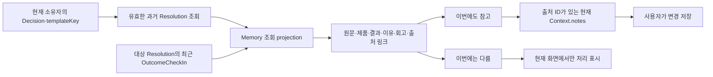

# 과거 판단 기록 활용

[전체 흐름](../domain.md) · [결정·비교](decision-comparison.md) · [회고·성향 기억](outcome-personalization.md) · [화면 모음](../ui/README.md)

## 책임과 범위

새 결정을 검토할 때 같은 제품군에서 과거에 내린 판단의 이유와 이후 회고를 원문으로 보여 준다. 사용자가 이번 상황에도 참고할지 선택하며, 과거 판단을 제품 사양이나 고정 취향으로 자동 변환하지 않는다. [ADR 0022](../decisions/0022-decision-reasons-and-reusable-history.md)의 AI 없는 첫 버전이며 별도 저장소·module·배포 단위를 추가하지 않는다.

## 모델과 관계

| 모델·정보 | 의미와 관계 |
|---|---|
| `DecisionMemoryController.Memory` | DB에 저장하는 새 entity가 아닌 읽기 projection이다. source decisionId·resolutionId·제목·결과·선택 제품·이유 ID·대표 이유·자유 메모·결정 시각·회고를 묶는다. |
| 과거 Resolution | 같은 소유자·templateKey의 현재 Decision 이외 기록이다. 최신 유효 기록 최대 3개를 조회하므로 같은 Decision의 여러 유효 판단이 포함될 수 있다. |
| OutcomeData | 각 source Resolution에 연결된 최근 회고 최대 2개다. 메모·만족도 등을 원문으로 읽으며 선택 사실에서 만족을 추정하지 않는다. |
| 현재 Context.notes | ‘이번에도 참고’를 선택하면 출처 decisionId/resolutionId와 이유·메모를 현재 draft에 추가한다. 서버에 남기려면 사용자가 저장해야 한다. |

과거 제품명은 해당 Resolution의 comparison snapshot에서 읽는다. 고정본이 없으면 현재 후보로 과거 제품명을 채우지 않는다. 조회 응답의 제목은 원본 Decision의 현재 제목이며 Resolution의 당시 제목 고정본과 구분한다.

## 조회·선택·저장의 생명주기

1. 현재 Decision의 소유권을 확인하고 같은 제품군에서 현재 결정 이외의 과거 기록을 찾는다.
2. 삭제 중·개인화 활용 해제·정정된 과거 Resolution·CORRECTION 진행 중 원본을 제외한다. 보관 여부만으로 제외하지 않는다.
3. 최근 유효 기록과 회고를 원문으로 표시하고 ‘당시 기록 보기’로 원본 결정을 연결한다.
4. ‘이번에도 참고’는 출처가 있는 메모만 현재 입력에 추가한다. 자동 저장·조건 판정·평가 weight 갱신은 하지 않는다.
5. ‘이번에는 다름’은 이번 화면의 처리 표시만 바꾼다. 장기적인 거부 성향이나 새 PreferenceMemory를 만들지 않는다.

참고 메모를 다른 결정에 이미 저장했다면 원본의 삭제·활용 설정 변경이 그 복사된 메모를 자동 삭제하거나 재작성하지 않는다. 이후 원본 조회·원문 제안에는 현재 권한·기록 수명 필터를 다시 적용한다.

## 기존 성향 기억과의 구분

| 경로 | 저장·사용 의미 | 자동 변경 경계 |
|---|---|---|
| 원문 판단 기록 참고 | 기존 Resolution·Outcome을 조회하고 사용자가 현재 메모에 선택 복사 | 사실·사양·조건·weight·고정 성향을 변경하지 않음 |
| 기존 PreferenceMemory | 회고에서 PROPOSED 기억 생성, 사용자 확인 후 같은 제품군 새 결정 기본 weight 적용 | CONFIRMED와 원본 활용 조건을 충족해야 적용 |

임베딩·AI 요약·유사 상황 검색·제품군 간 일반화는 제공하지 않는다. 긴 메모도 원문이며 외부 AI 호출·전송은 없다. 원문 참고의 유용성이나 실제 사용자 편의성은 자동 테스트 통과만으로 검증되지 않는다.

## 규칙·구현·검증

- 규칙: [BR-REASON-01, BR-OWN-01, BR-DELETE-01](../business-rules.md), [ADR 0022](../decisions/0022-decision-reasons-and-reusable-history.md).
- 구현: [DecisionMemoryController](../../backend/src/main/java/com/decisionassistant/decision/DecisionMemoryController.java), [PastDecisions](../../frontend/features/decision-editor/decision-reasons.tsx), [DecisionService](../../backend/src/main/java/com/decisionassistant/decision/DecisionService.java).
- 검증: `DecisionApiIntegrationTest.reasonsPurchaseReconsiderationAndMemoryRespectHistoryAndOwnership`, `frontend/e2e/decision-reasons.spec.ts`의 원문·출처 링크·명시적 메모 적용 사례. 촬영 fixture는 조회·보안·필터 정확성 검증을 대신하지 않는다.
