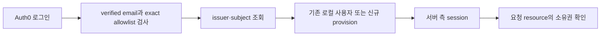

# 사용자·소유권

[전체 흐름](../domain.md) · [실행·보안 구조](../architecture.md)

## 책임과 범위

외부 인증 identity를 안정적인 내부 사용자에 연결하고 개인 결정 데이터의 접근을 제한한다. 인증 provider 교체가 domain의 소유권 식별자를 바꾸지 않도록 한다. 계정 전체 삭제·임의 identity 병합 등 새로운 정책은 여기서 정의하지 않는다.

## 모델과 관계

| 모델 | 의미 있는 속성과 관계 |
|---|---|
| ApplicationUser | domain ownership의 안정적인 로컬 UUID다. 알림 email 설정도 보유한다. |
| ExternalIdentity | Auth0의 issuer·subject 조합을 로컬 사용자에 연결한다. 이메일은 identity key가 아니다. |
| CurrentUser / CurrentUserProvider | 요청의 인증 정보를 domain에서 쓰는 내부 사용자 ID로 해석한다. |
| Decision.ownerUserId | 개인 Decision aggregate의 소유자다. |
| PreferenceMemory.ownerUserId | 성향 기억의 소유자이며 원본 Decision·Outcome 참조를 가진다. |

Evaluation·StructureRun·ProductDiscovery·CandidateSuggestion·EvidenceImport·Resolution·OutcomeCheckIn·OutcomeReminder는 Decision을 통해 접근 소유권을 따른다. CatalogProduct와 공유 template에는 개인 소유권을 적용하지 않는다.

과거 원문 기록의 Memory 조회도 현재 Decision의 소유권을 먼저 확인하고 같은 소유자·제품군의 기록만 제공한다. 삭제·활용 제외·정정된 기록과 정정 중 원본은 제외한다. 선택적인 MemoryInsight 조회·생성도 현재·원본 두 부모의 소유권과 원본 자격을 확인하고, 실제 전송 입력·외부 AI 동의를 별도로 확인한다. 영구 삭제 시 두 부모와 연결된 입력 snapshot·해석도 제거한다. 이 조회 projection·AI 해석은 기존 PreferenceMemory와 별개이며 자세한 수명·복사 경계는 [과거 판단 기록 활용](history-reuse.md)을 따른다.

## 로그인과 접근의 생명주기

운영에서는 OpenID Connect(OIDC) Authorization Code + PKCE와 서버 측 session을 사용한다. Google 또는 email OTP 로그인을 Auth0 Universal Login에서 수행한다. verified email이 배포의 exact-email allowlist에 있을 때만 provision·접근을 허용한다. 이메일이 같아도 다른 issuer/subject를 자동 병합하지 않는다. 로그인에 성공하면 이전에 요청한 경로와 관계없이 항상 `/`로 이동한다. 페이지는 Next.js가 제공하므로 backend는 인증되지 않은 요청을 저장해 두었다가 되돌려 보내지 않는다([로그인 직후 backend 내부 주소로 이동하는 경우](../troubleshooting/login-saved-request-redirect.md)).

로그인이 실패하면(allowlist·verified email·identity 충돌에 따른 접근 거부와 Auth0 오류 응답 포함) 실패 처리기가 서버 session에 재인증 표시를 남긴다. 표시가 있는 session의 authorization request에는 PKCE와 함께 `prompt=login`을 붙여 Auth0에 로그인 화면을 다시 요구한다. 접근 거부 뒤 살아 있는 Auth0 session이 같은 계정을 다시 사용하는 것이 계정 전환 실패([#84](https://github.com/lawliet62/Decision-Assistant/issues/84))의 원인이라고 추정하지만 운영 tenant에서 확인하지 않았다. 표시는 첫 재시도에서 소모하지 않고 로그인 성공 시 지운다. 따라서 Auth0 화면을 벗어났다가 다시 로그인해도 요청에 `prompt=login`이 계속 붙는다. session fixation 보호가 session 속성을 새 session으로 옮기므로 성공 시 명시적으로 지우며, 이후 같은 browser session의 로그인이나 로그아웃 뒤 로그인은 첫 로그인처럼 `prompt`를 보내지 않는다. 표시는 요청 parameter로 해제할 수 없고 요청으로 다른 authorization parameter를 넣을 수도 없다. 다만 실패로 끝나는 callback 요청은 표시를 설정하며, 그 영향은 같은 session에서 로그인이 성공할 때까지 Auth0 로그인 화면을 다시 요구하는 것이다. 표시는 session이 만료되면 함께 사라진다. Auth0 로그아웃 호출이나 tenant 설정 변경은 하지 않는다.

`prompt=login`은 Auth0 로그인 화면만 다시 요구한다. 그 화면에서 Google을 고를 때 Google 계정 선택 화면이 나오는지는 Google 측 session에 달려 있다. 이를 보장하려면 tenant의 Google connection이 `prompt=select_account`를 upstream으로 전달해야 하며([Auth0 Pass Parameters to Identity Providers](https://auth0.com/docs/authenticate/identity-providers/pass-parameters-to-idps)의 `options.upstream_params`), 이 설정은 이 저장소의 변경 범위가 아니고 검증하지 않았다. 운영 tenant에서의 실제 효과도 아직 검증하지 않았다. 운영 점검 항목은 [배포 사전 조건](../../deploy/README.md#실제-배포의-사전-조건)에 둔다.

session은 PostgreSQL에 저장하고 7일 비활성 시 만료한다. 브라우저에는 HttpOnly·Secure·SameSite=Lax session cookie를 사용하고 access token을 노출하지 않는다. 변경 요청은 same-origin의 교차 사이트 요청 위조(CSRF) cookie/header를 검사한다.

## 불변 조건과 다른 도메인의 경계

사용자 resource는 현재 내부 UUID로 scope한다. 타인 resource와 없는 resource에는 모두 404를 반환해 존재 여부도 공개하지 않는다. 인증됐다는 사실만으로 다른 사용자의 결정이나 snapshot을 읽을 수 없다.

local profile의 고정 개발 사용자는 loopback 개발용이며 기본·운영 실행의 인증 우회가 아니다. offline은 외부 provider·Secret 없이 개발하는 설정으로 local 인증과 역할이 다르다. 실행 방법은 [Development workflow](../development.md)를 따른다.

Decision 삭제는 계정·ExternalIdentity를 삭제하지 않는다. 카탈로그가 공용이라는 이유로 개인 후보·조건·회고를 공유하지 않는다. 외부 provider로 보내는 정보는 접근 권한 외에 각 기능의 명시적 전송 동의도 충족해야 한다.

## 규칙·구현·검증

- 규칙: [BR-AUTH-01, BR-OWN-01](../business-rules.md), [인증·운영 경계](../architecture.md#securityoperations-baseline).
- 구현: [ApplicationUser](../../backend/src/main/java/com/decisionassistant/identity/ApplicationUser.java), [ExternalIdentity](../../backend/src/main/java/com/decisionassistant/identity/ExternalIdentity.java), [UserProvisioningService](../../backend/src/main/java/com/decisionassistant/identity/UserProvisioningService.java), [SecurityConfiguration](../../backend/src/main/java/com/decisionassistant/identity/SecurityConfiguration.java), [LoginRetryReauthentication](../../backend/src/main/java/com/decisionassistant/identity/LoginRetryReauthentication.java).
- 검증: `DecisionApiIntegrationTest`의 인증·CSRF·소유권 사례, 실패 후 재로그인의 `prompt=login` 수명과 로그인 성공 뒤 `/` 이동을 OIDC filter chain으로 확인하는 `LoginRetrySecurityTest`와 [규칙별 검증 표](../business-rules.md#현재-검증-상태). UI mock 화면은 Auth0 로그인이나 실제 세션 보안을 검증하지 않는다.
