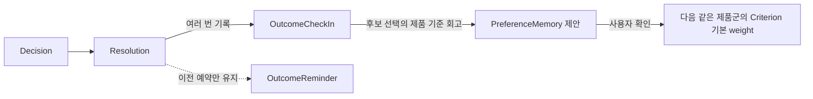

# 회고·알림·개인화

[전체 흐름](../domain.md) · [화면 모음](../ui/README.md)

## 책임과 범위

완료한 결정의 선택적 사후 결과를 기록하고 사용자가 검토할 수 있는 성향 기억을 다음 결정의 기본값으로 연결한다. 필수 절차는 결정 완료에서 끝난다. [과거 이유·회고 원문 참고와 선택적 AI 해석](history-reuse.md)은 PreferenceMemory와 별도 경로다. AI 해석을 ‘이번에도 중요함’으로 현재 메모에 추가해도 성향 기억을 CONFIRMED로 바꾸거나 weight를 자동 변경하지 않는다. 자동 학습 모델이나 사용자 모르게 바뀌는 weight를 제공하지 않는다. 세 영역은 완료 기록을 중심으로 연결되지만 상태와 적용 조건은 서로 다르다.

## 모델과 관계

| 모델·속성 | 의미 |
|---|---|
| OutcomeCheckIn | satisfaction·expectationStatus·notes·wouldChooseAgain과 제품 기준 회고를 기록한다. decisionId로 소유권, resolutionId로 회고 대상을 연결한다. |
| OutcomeReminder | decisionId·resolutionId, dueAt·channel·status·시도 수·전송 결과를 보존한다. |
| PreferenceMemory | ownerUserId·templateKey·criterionName·statement·strength·status·confidence와 원본 Decision/Outcome을 가진 projection이다. |
| supersededAt | 정정으로 대체된 성향의 활용·재확인을 막는다. DISMISSED나 삭제와는 다르다. |

## 회고 생명주기

CHOSEN·DEFERRED·ABANDONED 상태에서 선택적으로 회고를 여러 번 추가할 수 있다. 완료했거나 구매 상태가 미기록이라는 이유만으로 사용 경험·만족도를 추정하지 않는다. 구매하지 않음의 회고는 제품 사용 만족도가 아닌 결정에 대한 회고이며 제품 기준 성향을 제안하지 않는다. 정정·재검토 후에는 대상 resolutionId와 최신 version이 필요하다. 연결 정보가 없는 과거 회고를 현재 선택에 소급 연결하지 않는다.

CHOSEN의 회고에서 잘 맞은 criterion은 strength 3, 아쉬운 criterion은 strength 2인 PROPOSED 기억을 만들 수 있다. 만족도만으로 모든 기준을 학습하거나 제품군을 넘어 일반화하지 않는다.

## 알림 생명주기

신규 완료에는 자동 알림을 생성하지 않는다. 이전 버전에서 생성한 14일·60일 EMAIL·IN_APP 예약은 해당 Resolution과 연결된 기존 기록으로 관리한다. 새 완료·재검토 완료 후에도 자동 예약하지 않는다.

| 상태·동작 | 의미 |
|---|---|
| PENDING | 예정 또는 재시도 대기다. |
| SENT | 전송한 알림이다. provider message ID와 sentAt을 보존한다. |
| FAILED | 전송 실패가 3회에 도달한 상태다. 그 전에는 시도 수×10분 후 PENDING으로 재예약한다. |
| COMPLETED | 회고 완료 처리된 알림이다. |
| SKIPPED | 사용자 건너뛰기 또는 정정·재검토로 중단한 알림이다. |
| RESCHEDULE | 현재 CHOSEN의 현재 Resolution 알림만 다시 예약한다. |

계정의 reminderEmailsEnabled로 email 수신을 끌 수 있다. 이메일은 reminder ID로 중복 전송을 막는다. 정정·재검토 시작 시 기존 미완료 알림을 중단한다. 취소로 draft·결론을 복원하는 것이 기존 중단 알림의 재예약을 뜻하지 않는다. 삭제·정정과 발송은 같은 부모 잠금 순서를 사용하지만 이미 전송한 메일은 취소하지 않는다.

## 성향 기억 생명주기와 적용

| 동작 | 상태·효과 |
|---|---|
| 회고에서 제안 | PROPOSED, 초기 confidence LOW. 평가 기본값에 사용하지 않는다. |
| CONFIRM | CONFIRMED로 변경한다. |
| EDIT | statement·strength를 수정하고 CONFIRMED로 변경한다. |
| DISMISS | DISMISSED로 변경해 적용 대상에서 제외한다. |
| DELETE | 해당 기억을 삭제한다. |

새 Decision 생성 시 같은 소유자·templateKey의 CONFIRMED 기억 중 criterionName이 일치하는 기준의 기본 weight에 strength를 1-3으로 제한해 적용한다. 적용 내역을 표시하며 이미 만들어진 다른 결정의 값을 자동 갱신하지 않는다.

적용에는 원본이 휴지통에 없고 personalizationEnabled가 켜져 있으며 정정 중이 아니고 기억이 superseded되지 않았다는 조건이 추가된다. 보관은 활용을 막지 않는다. 정정 완료는 원본 Resolution 및 연결 불명 과거 회고에서 나온 기억을 활용·재확인 대상에서 제외하며 삭제하지는 않는다. 재검토는 과거 유효한 기억을 무효화하지 않는다.

원본 삭제 시 기억을 조회·활용에서 제외하고 복구하면 기존 기억을 다시 사용할 수 있다. 유예 만료 후 원본의 모든 상태 기억도 연쇄 삭제한다. 다른 결정에 이미 복사된 기본값은 유지한다.

## 규칙·구현·검증

- 규칙: [BR-REASON-01, BR-DEC-05-06, BR-PREF-01, BR-DELETE-01](../business-rules.md), [ADR 0006](../decisions/0006-guided-evidence-and-inspectable-memory.md), [ADR 0020](../decisions/0020-decision-retention-and-personalization.md), [ADR 0021](../decisions/0021-decision-completion-and-revisions.md), [ADR 0022](../decisions/0022-decision-reasons-and-reusable-history.md).
- 구현: [OutcomeCheckIn](../../backend/src/main/java/com/decisionassistant/decision/OutcomeCheckIn.java), [OutcomeReminder](../../backend/src/main/java/com/decisionassistant/notification/OutcomeReminder.java), [OutcomeReminderWorker](../../backend/src/main/java/com/decisionassistant/notification/OutcomeReminderWorker.java), [PreferenceService](../../backend/src/main/java/com/decisionassistant/preference/PreferenceService.java), [PreferenceMemoryRepository](../../backend/src/main/java/com/decisionassistant/preference/PreferenceMemoryRepository.java).
- 검증: `DecisionApiIntegrationTest`의 회고·성향·정정·삭제·알림 경합 사례, `frontend/e2e/decision-revisions.spec.ts`, `frontend/e2e/decision-list.spec.ts`.
