# UI 화면 모음

[도메인 개요](../domain.md) · [실행 구조](../architecture.md) · [현재 완료·구매 정책](../decisions/0022-decision-reasons-and-reusable-history.md) · [선택적 AI 해석](../decisions/0023-contextual-decision-memory.md)

개발자가 사용자 흐름과 도메인 상태를 함께 살펴보는 대표 화면 모음이다. 25개 장면을 데스크톱·모바일 50장으로 제공한다. 각 장면은 대표 상태이며 일부는 별도 draft·고정 fixture를 사용하므로 한 사용자의 연속된 실제 이력이 아니다. 과거 검증 자료는 [evaluations](../evaluations/)에 그대로 보존한다.

## 촬영 기준과 한계

- 촬영일: 2026-11-26. PR #97이 병합된 애플리케이션을 기준으로 한다. 정확한 commit·실행 시각·경로·상태·viewport는 [capture-manifest.json](capture-manifest.json)이 원본이다.
- 환경: 현재 worktree의 Next.js 개발 서버 + 기존 Playwright mock backend + Chromium, ko-KR, Asia/Seoul.
- 데이터: 가상 Alpha/Beta 등의 E2E fixture다. 이유 목록은 현재 backend의 DecisionReasons 소스에서 읽어 전체 템플릿을 표시하며, 성향·email 설정·과거 원문 기록 조회와 AI 입력·결과·실패는 촬영용 응답이다. 실제 AI provider 호출·외부 전송은 없다. 실제 사용자·개발 DB·외부 provider·상품 이미지를 사용하지 않는다.
- 목록 화면의 제품군 navigation은 서버 측 기존 mock capabilities에 따라 5개 제품군을 표시한다. 실제 기본 카탈로그의 추천 범위는 이어폰이며 이 모음이 다른 제품군 카탈로그 지원을 뜻하지 않는다.
- 크기: 데스크톱 1440×1000, 모바일 390×844 viewport의 전체 페이지다. Next.js 개발 도구 overlay만 숨기며 원본 이미지는 viewport보다 길 수 있다.
- 자료의 범위: 실제 frontend의 배치·문구·조작을 보여 준다. 실제 판매가·판정·메일·Auth0·운영 DB·취소 복원·원문 기록의 권한/필터·AI 입력 hash·결과 재사용·삭제 경합 정확성은 backend 검증을 참고한다. 가상 요약의 배치·조작 검증은 실제 모델의 의미 정확성·유용성 평가가 아니다. 실패·충돌의 모든 조합은 포함하지 않는다.
- 필수 흐름은 제품 선택·보류·포기의 완료에서 끝난다. 구매·회고는 선택 사항이며 신규 자동 알림은 없다. 기존 성향 기억과 새 원문 참고는 별도 경로다.

## 화면 순서

| 과정 | 화면 | 관련 도메인 |
|---|---|---|
| 1 | [조건 선택](#화면-1) | [탐색·근거](../domains/discovery-evidence.md) |
| 2 | [추천 후보](#화면-2) | [카탈로그](../domains/catalog.md) |
| 3 | [과거 이유·회고 원문 참고](#화면-3) | [과거 판단 기록 활용](../domains/history-reuse.md) |
| 4 | [후보 조건 비교](#화면-4) | [결정·비교](../domains/decision-comparison.md) |
| 5 | [직접 확인](#화면-5) | [결정·비교](../domains/decision-comparison.md) |
| 6 | [선택적 점수 평가 입력](#화면-6) | [평가](../domains/evaluation.md) |
| 7 | [선택적 점수 평가 결과](#화면-7) | [평가](../domains/evaluation.md) |
| 8 | [결과별 이유와 결정 완료](#화면-8) | [결정·비교](../domains/decision-comparison.md) |
| 9 | [완료에서 필수 흐름 종료](#화면-9) | [결정·비교](../domains/decision-comparison.md) |
| 10 | [선택적인 회고](#화면-10) | [회고·개인화](../domains/outcome-personalization.md) |
| 11 | [원본 이유를 보존하는 정정](#화면-11) | [결정·비교](../domains/decision-comparison.md) |
| 12 | [포기로 완료](#화면-12) | [결정·비교](../domains/decision-comparison.md) |
| 13 | [보류도 결정 완료](#화면-13) | [결정·비교](../domains/decision-comparison.md) |
| 14 | [다시 검토](#화면-14) | [결정·비교](../domains/decision-comparison.md) |
| 15 | [재검토 취소와 원래 결론 복원](#화면-15) | [결정·비교](../domains/decision-comparison.md) |
| 16 | [별도 구매 기록](#화면-16) | [결정·비교](../domains/decision-comparison.md) |
| 17 | [결정 목록](#화면-17) | [결정·비교](../domains/decision-comparison.md) |
| 18 | [보관함](#화면-18) | [결정·비교](../domains/decision-comparison.md) |
| 19 | [휴지통](#화면-19) | [결정·비교](../domains/decision-comparison.md) |
| 20 | [기존 성향 확인·알림 설정](#화면-20) | [회고·개인화](../domains/outcome-personalization.md) |
| 21 | [AI 전송 내용·동의 확인](#화면-21) | [기록 활용](../domains/history-reuse.md) |
| 22 | [AI 해석과 조건·불확실성](#화면-22) | [기록 활용](../domains/history-reuse.md) |
| 23 | [사용자 해석 수정](#화면-23) | [기록 활용](../domains/history-reuse.md) |
| 24 | [현재 메모 적용·미저장 보호](#화면-24) | [기록 활용](../domains/history-reuse.md) |
| 25 | [AI 실패와 원문 유지](#화면-25) | [기록 활용](../domains/history-reuse.md) |

<a id="화면-1"></a>

## 1. 조건 선택

진입: `/decisions/new`. 기본 카탈로그에서 용도·예산·ANC를 선택한다. 검색·수집·AI 동의 없이 시작한다.

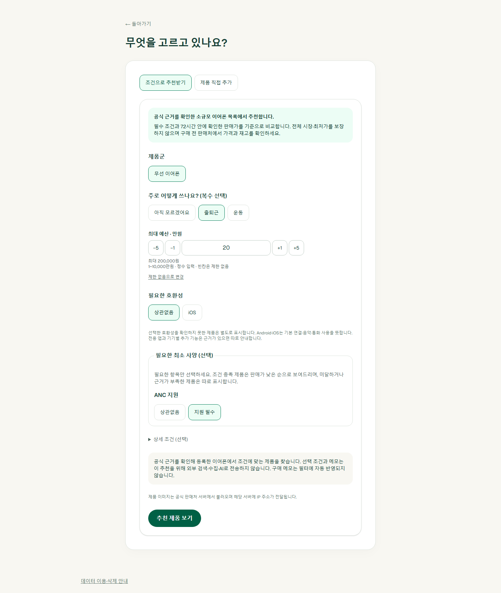

<details>
<summary>모바일 화면 보기</summary>


</details>

<a id="화면-2"></a>

## 2. 추천 후보

진입: `/decisions/{id} · 추천`. 아직 Option이 아닌 제안이다. 충족·미달·미확인과 가격·사양 확인 시각을 구분한다.


<details>
<summary>모바일 화면 보기</summary>

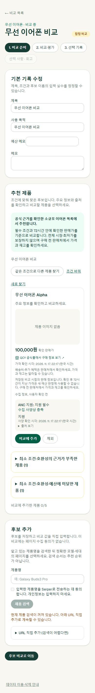

</details>

<a id="화면-3"></a>

## 3. 과거 이유·회고 원문 참고

진입: `/decisions/{id} · 비교 준비`. 같은 제품군의 과거 이유·회고와 출처를 보여준다. ‘이번에도 참고’는 현재 메모에만 추가하고 변경 저장으로 보존한다. 이 장면의 원문 조회는 고정 가상 응답이다.

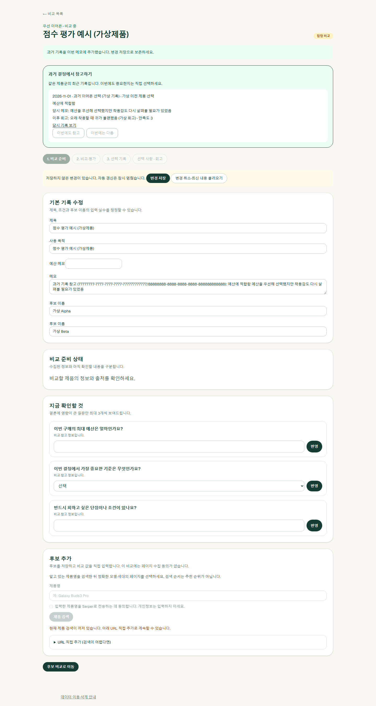

<details>
<summary>모바일 화면 보기</summary>

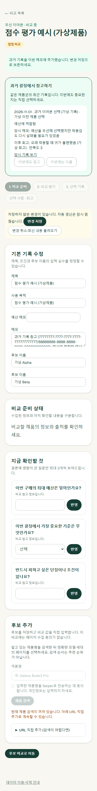

</details>

<a id="화면-4"></a>

## 4. 후보 조건 비교

진입: `/decisions/{id} · 2. 비교·평가`. 현재 비교 조건을 바꿔도 후보와 최초 추천 조건은 유지한다. 후보 비교 보류는 완료 결과의 보류와 다르다.

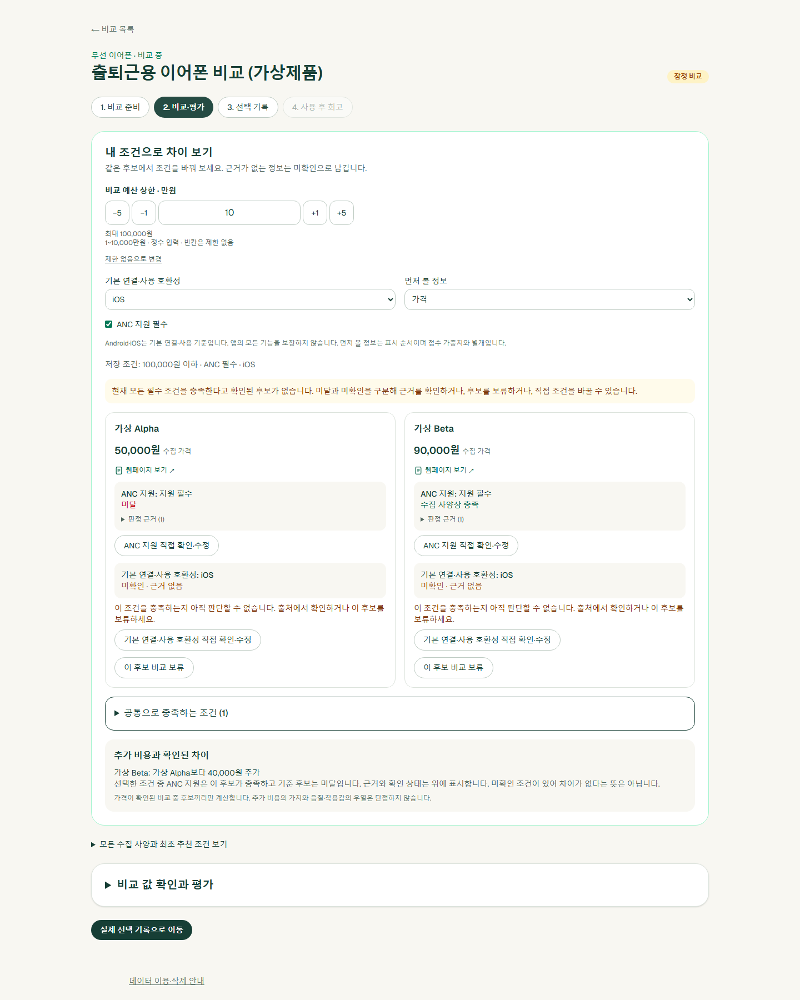

<details>
<summary>모바일 화면 보기</summary>


</details>

<a id="화면-5"></a>

## 5. 직접 확인

진입: `/decisions/{id} · 기능 확인 입력`. 직접 확인은 해당 후보·기능·플랫폼에만 적용하며 수집 근거와 구분한다.

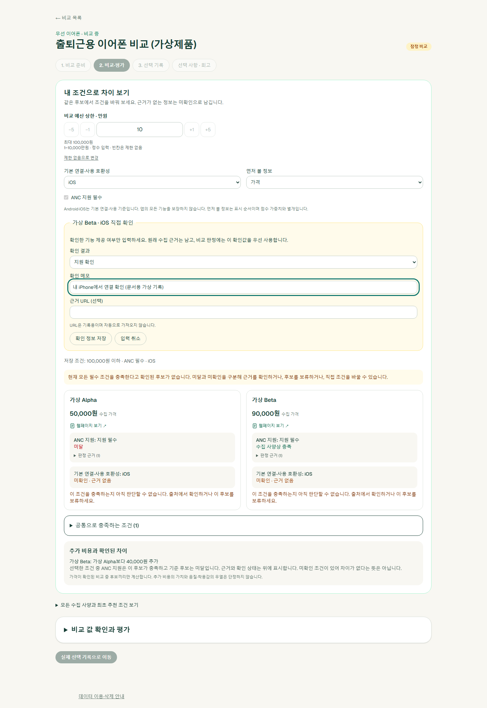

<details>
<summary>모바일 화면 보기</summary>

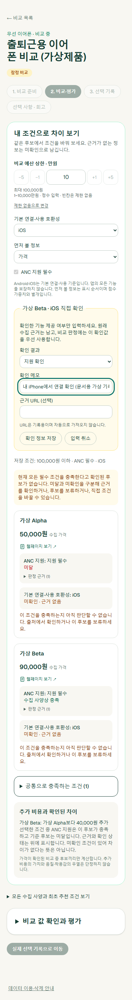

</details>

<a id="화면-6"></a>

## 6. 선택적 점수 평가 입력

진입: `/decisions/{id} · 비교 값 확인과 평가`. 가격과 예상 만족도는 표시 사양과 별개다. 평가 없이 결정 완료할 수도 있다.


<details>
<summary>모바일 화면 보기</summary>


</details>

<a id="화면-7"></a>

## 7. 선택적 점수 평가 결과

진입: `/decisions/{id} · 평가 결과`. mock 응답을 표시한 UI다. 점수의 정확성·실제 알고리즘·외부 AI 품질을 검증한 자료가 아니다.

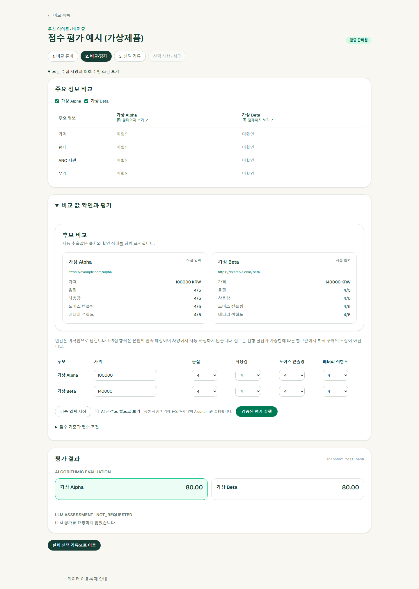

<details>
<summary>모바일 화면 보기</summary>

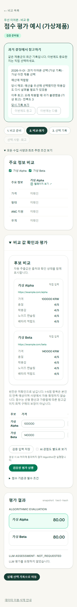

</details>

<a id="화면-8"></a>

## 8. 결과별 이유와 결정 완료

진입: `/decisions/{id} · 3. 선택 기록`. 제품 선택·보류·포기별 이유와 대표 이유·자유 메모를 선택적으로 남긴다. 판단 이유는 사양·평가 weight를 바꾸지 않는다.


<details>
<summary>모바일 화면 보기</summary>

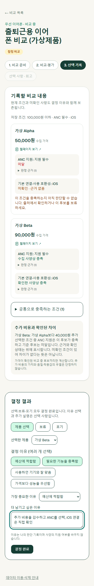

</details>

<a id="화면-9"></a>

## 9. 완료에서 필수 흐름 종료

진입: `/decisions/{id} · 완료`. 제품 선택 완료와 구매를 분리한다. 구매 미기록은 미구매의 증거가 아니며 구매·회고는 선택 사항이다. 새 자동 회고 알림을 만들지 않는다. 완료한 결정의 개인화 활용 상태를 이 화면에서 확인하고 켜거나 끌 수 있다.

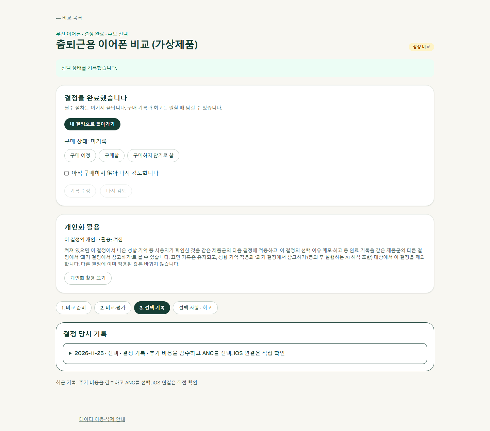

<details>
<summary>모바일 화면 보기</summary>

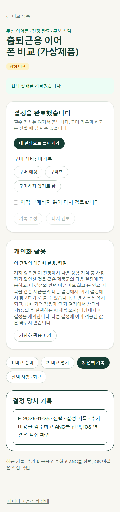

</details>

<a id="화면-10"></a>

## 10. 선택적인 회고

진입: `/decisions/{id} · 선택 사항 · 회고`. 대상 완료 기록에 회고를 연결한다. 사용 경험과 메모는 가상 데이터이며 실제 만족을 검증하지 않는다.

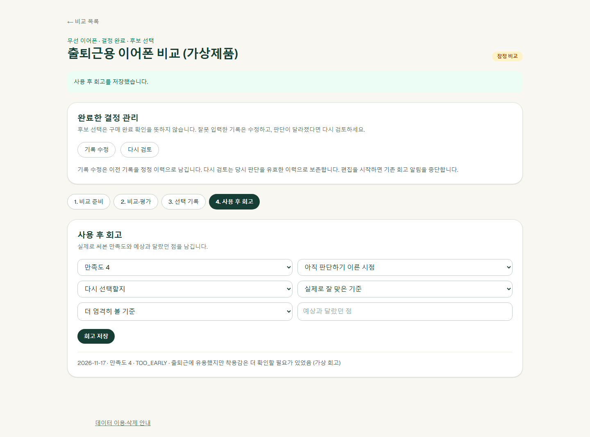

<details>
<summary>모바일 화면 보기</summary>

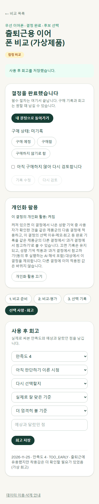

</details>

<a id="화면-11"></a>

## 11. 원본 이유를 보존하는 정정

진입: `/decisions/{id} · 기록 수정 중`. 미구매 확인 후 원본의 결과·선택 제품·복수 이유·대표 이유·메모를 초기값으로 정정한다. 보류도 완료 결과로 선택할 수 있다.


<details>
<summary>모바일 화면 보기</summary>

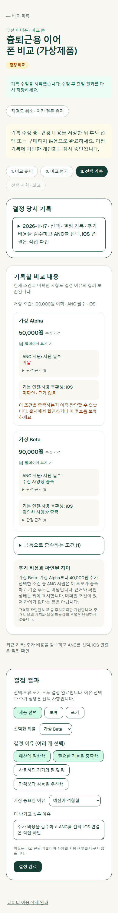

</details>

<a id="화면-12"></a>

## 12. 포기로 완료

진입: `/decisions/{id} · 결정 후 회고`. 포기는 완료 결과다. 기존 result=NOT_PURCHASED와 선택 후 purchaseStatus=NOT_PURCHASED를 구분한다. 회고는 선택적으로 남긴다.

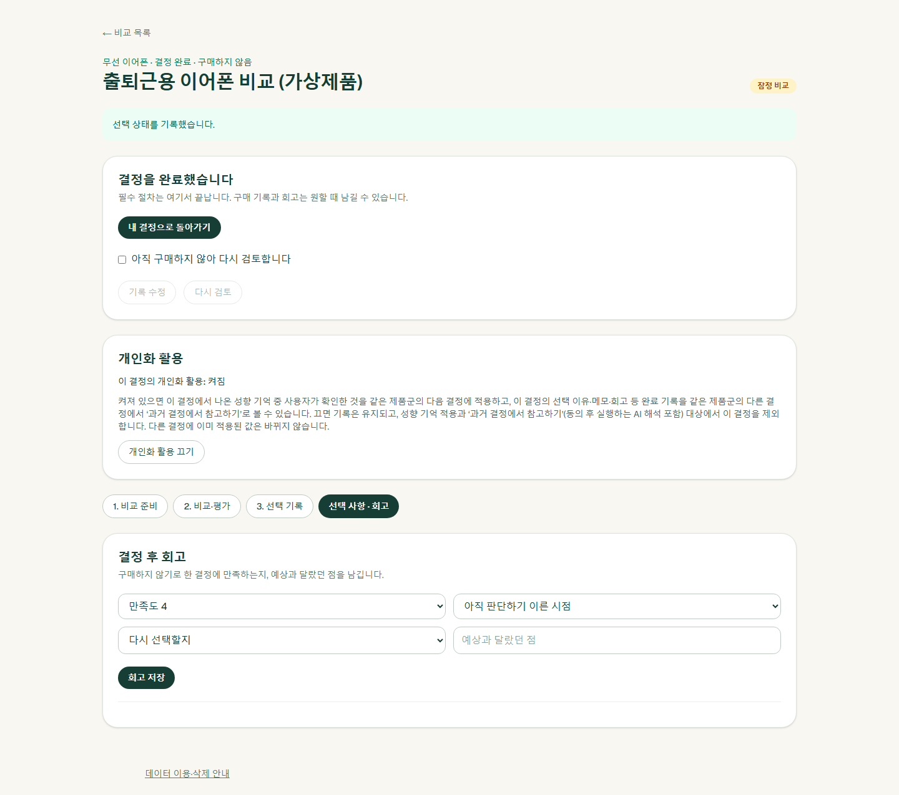

<details>
<summary>모바일 화면 보기</summary>


</details>

<a id="화면-13"></a>

## 13. 보류도 결정 완료

진입: `/decisions/{id} · 완료 · 보류`. 보류 상태도 직접 편집하지 않는다. 미구매 명시 확인과 최신 version으로 검토를 재개한다.

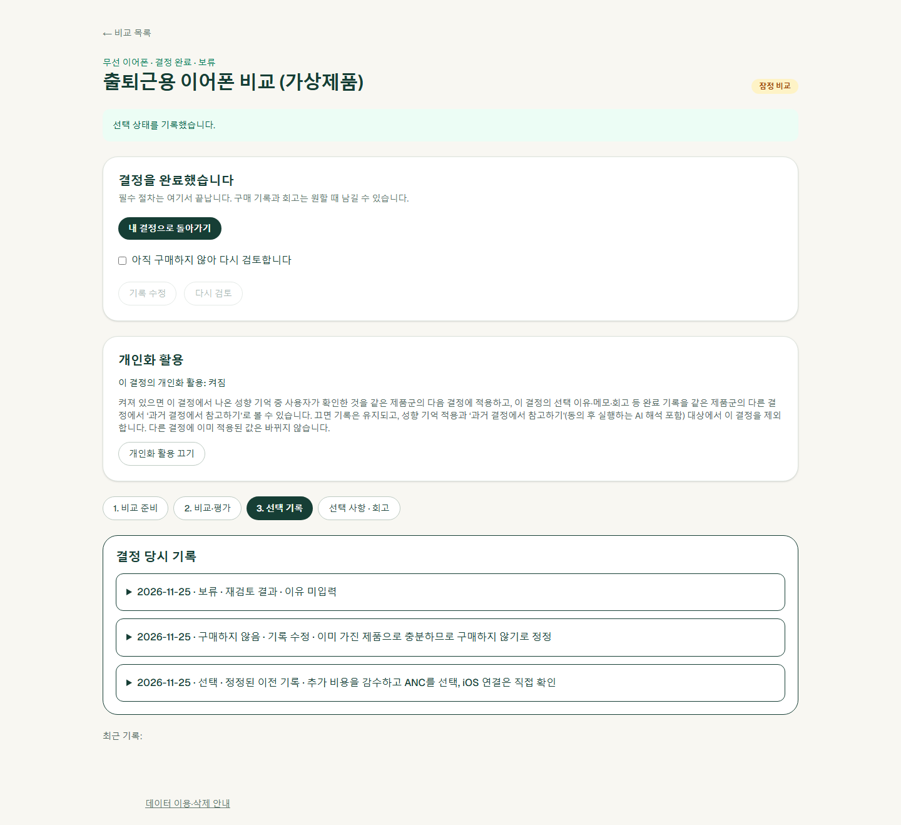

<details>
<summary>모바일 화면 보기</summary>

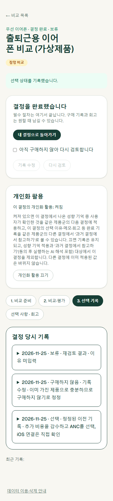

</details>

<a id="화면-14"></a>

## 14. 다시 검토

진입: `/decisions/{id} · 다시 검토 중`. 이전 판단·근거·회고를 보존하고 새 draft를 편집한다. 시작 전 입력·후보 선택 복원본이 있는 검토는 취소할 수 있다.

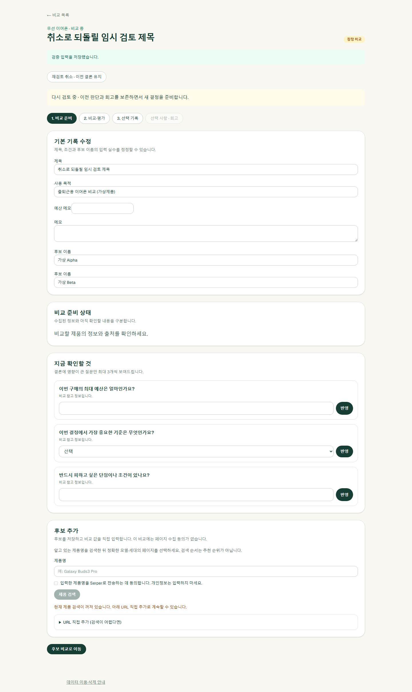

<details>
<summary>모바일 화면 보기</summary>

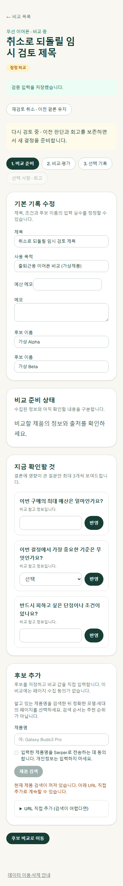

</details>

<a id="화면-15"></a>

## 15. 재검토 취소와 원래 결론 복원

진입: `/decisions/{id} · 취소 후 완료`. 임시 제목 수정 후 취소해 이전 제목·보류 결론을 복원한 UI다. 추천 후보의 수락·제외·연결까지 복원하는 backend 동작은 API 통합 테스트를 참고한다.

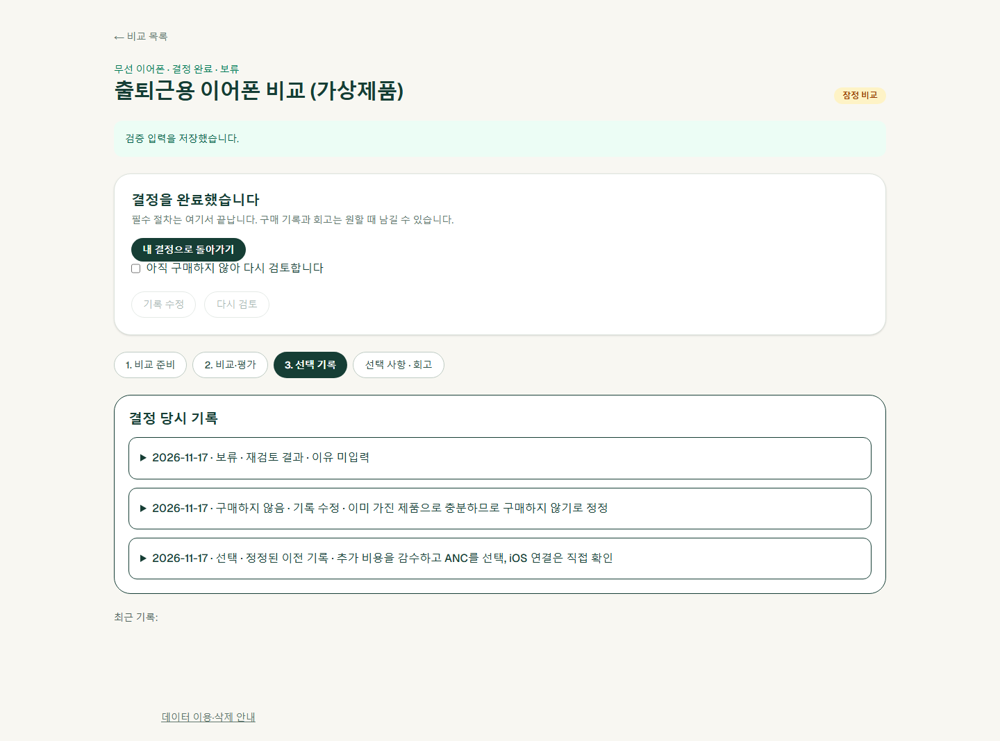

<details>
<summary>모바일 화면 보기</summary>


</details>

<a id="화면-16"></a>

## 16. 별도 구매 기록

진입: `/decisions/{id} · 구매함`. 구매 예정에서 구매함으로 기록한 상태다. 구매함 이후 구매 상태 변경·정정·재검토는 차단한다. 반품·환불은 범위 밖이다.

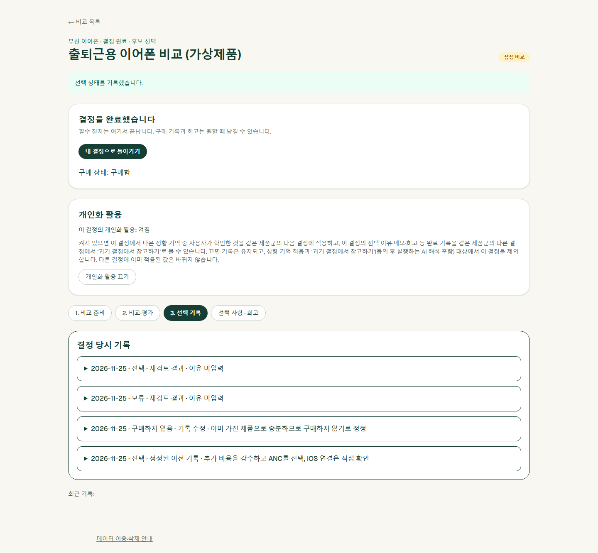

<details>
<summary>모바일 화면 보기</summary>

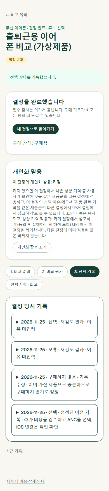

</details>

<a id="화면-17"></a>

## 17. 결정 목록

진입: `/?open=DRAFT,CHOSEN`. 소유자 범위의 진행·완료 그룹과 목록 관리를 확인한다. 보류도 완료 그룹에 포함한다.

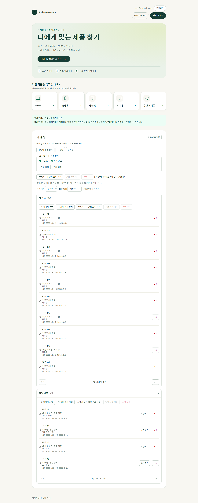

<details>
<summary>모바일 화면 보기</summary>

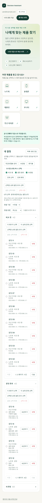

</details>

<a id="화면-18"></a>

## 18. 보관함

진입: `/ · 보관함`. 완료 상태를 유지하며 목록을 정리한다. 보관과 개인화 활용 중단은 별개다.

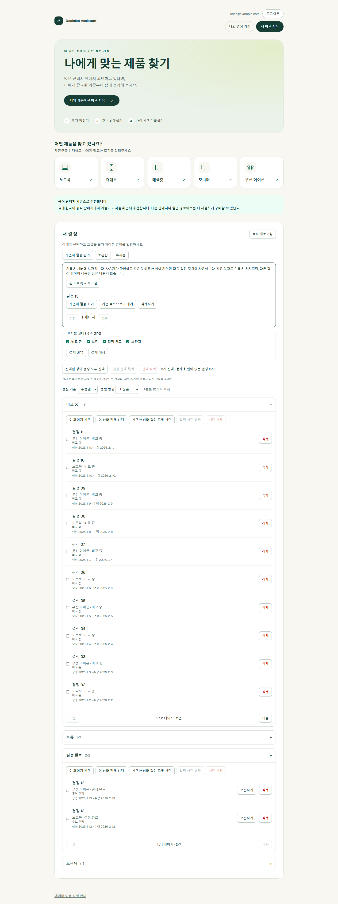

<details>
<summary>모바일 화면 보기</summary>

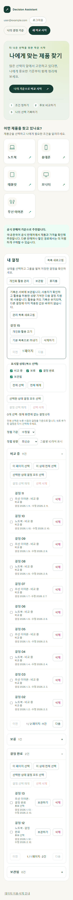

</details>

<a id="화면-19"></a>

## 19. 휴지통

진입: `/ · 휴지통`. 복구 기한과 복구 동작을 확인한다. 삭제 중에는 개인화·원문 참고·후속 작업에서 제외된다.


<details>
<summary>모바일 화면 보기</summary>

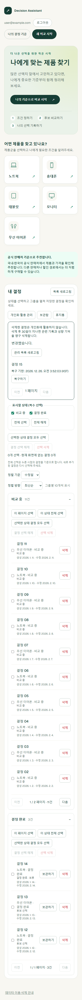

</details>

<a id="화면-20"></a>

## 20. 기존 성향 확인·알림 설정

진입: `/preferences`. 기존 PROPOSED 성향을 확인하고 과거 예약에 대한 email 설정을 관리한다. 원문 기록 참고와 별도이며 새 완료가 알림을 자동 생성한다는 뜻은 아니다.


<details>
<summary>모바일 화면 보기</summary>

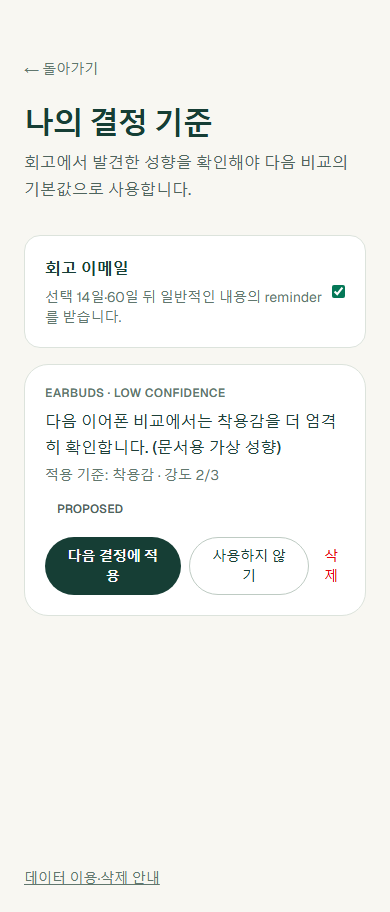

</details>

<a id="화면-21"></a>

## 21. AI 전송 내용·동의 확인

진입: `/decisions/{id} · 과거 결정에서 참고하기`. 실제 전송 항목·provider/model 고지를 확인하고 민감정보 미포함·외부 전송에 동의한다. 현재 메모는 입력에서 제외한다. 촬영에서는 POST 응답도 가상 처리한다.

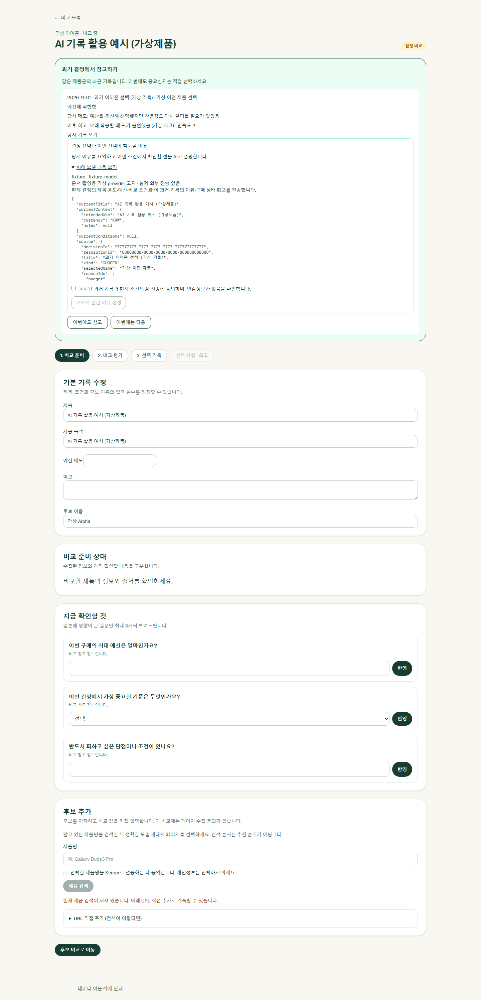

<details>
<summary>모바일 화면 보기</summary>

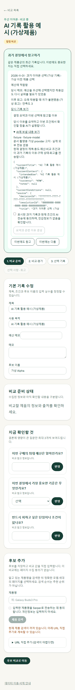

</details>

<a id="화면-22"></a>

## 22. AI 해석과 조건·불확실성

진입: `/decisions/{id} · 과거 결정에서 참고하기`. 당시 요약·현재 조건에 따른 관련성·적용 조건·불확실성을 AI 해석으로 표시한다. 원본 링크를 유지하며 사양·호환성을 확정하지 않는다.

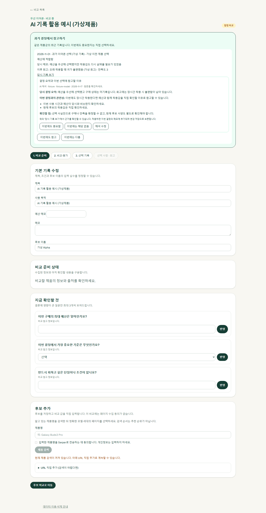

<details>
<summary>모바일 화면 보기</summary>

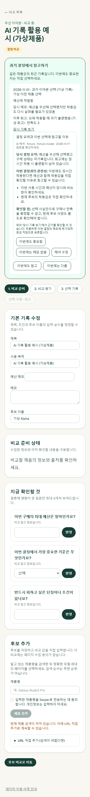

</details>

<a id="화면-23"></a>

## 23. 사용자 해석 수정

진입: `/decisions/{id} · 과거 결정에서 참고하기`. 사용자가 해석을 현재 상황에 맞게 수정한다. 원본 이유나 장기 성향 기억을 변경하는 동작은 아니다.

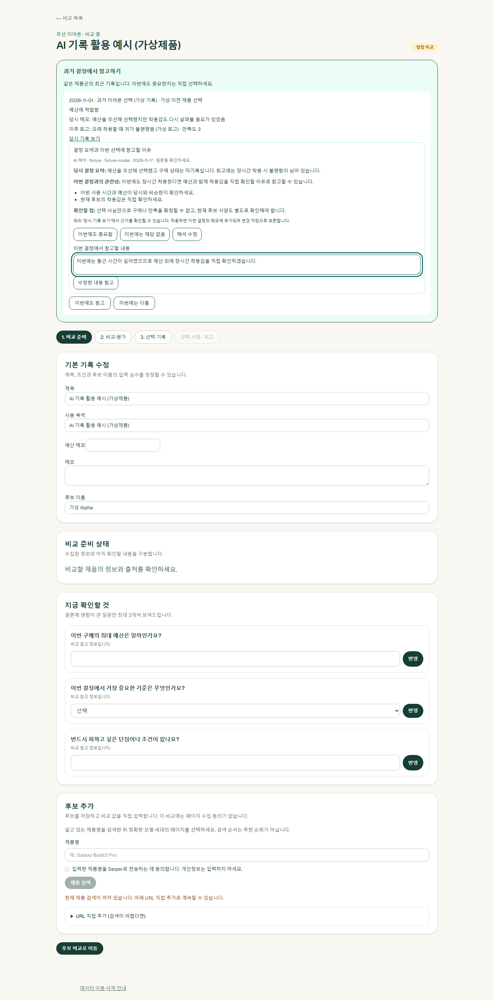

<details>
<summary>모바일 화면 보기</summary>

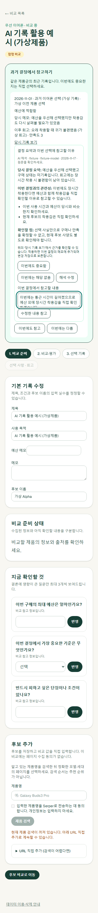

</details>

<a id="화면-24"></a>

## 24. 현재 메모 적용·미저장 보호

진입: `/decisions/{id} · 과거 결정에서 참고하기`. 출처 ID와 수정한 해석을 현재 메모에 추가한다. 저장 전에는 추가 AI 생성·적용을 막는다. 촬영은 저장·재조회 뒤 메모와 저장 결과 표시도 확인한다.

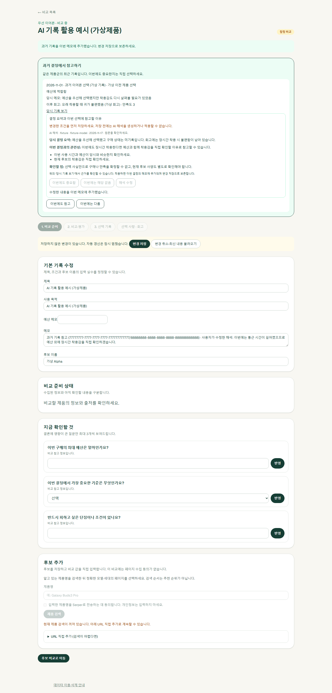

<details>
<summary>모바일 화면 보기</summary>

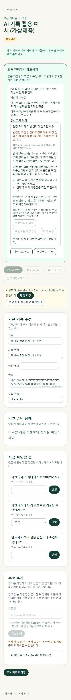

</details>

<a id="화면-25"></a>

## 25. AI 실패와 원문 유지

진입: `/decisions/{id} · 과거 결정에서 참고하기`. 실패해도 원문을 계속 참고할 수 있고 재전송 입력을 확인하도록 안내한다. 이 장면은 별도 실패 fixture이며 실제 hash 무효화·provider 실패를 검증하지 않는다.

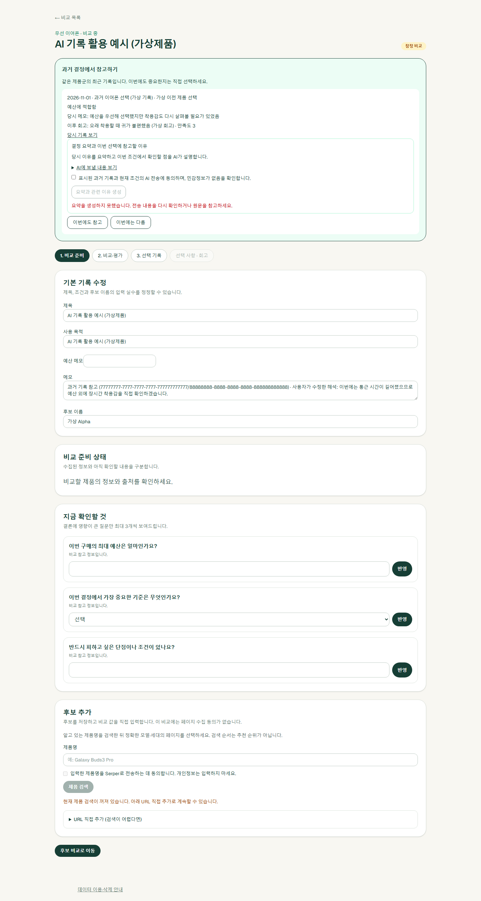

<details>
<summary>모바일 화면 보기</summary>

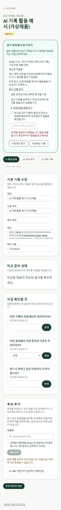

</details>

## 재촬영과 유지 방법

현재 branch의 의존성을 설치한 뒤 저장소 루트에서 실행한다. 3100·18080 포트가 비어 있어야 하며 기존 서버를 재사용하지 않는다. 일반 E2E는 문서 이미지를 덮어쓰지 않는다.

```powershell
npm.cmd --prefix frontend ci
npm.cmd --prefix frontend exec -- playwright install chromium
npm.cmd --prefix frontend run test:e2e -- --config playwright.docs.config.ts
```

촬영 구성은 [playwright.docs.config.ts](../../frontend/playwright.docs.config.ts), 상태 재현과 metadata 생성은 [ui-gallery.capture.ts](../../frontend/e2e/ui-gallery.capture.ts)에 있다. 모든 장면이 성공한 뒤 문서 자산을 갱신한다. 애플리케이션 변경을 commit한 뒤 촬영해야 manifest의 기준 commit이 실제 실행 코드와 일치한다.

이미지를 직접 열어 로딩 중 화면·오류·잘림·불필요한 개인정보가 없는지 확인한다. [촬영 준비 상태 진단](../troubleshooting/ui-gallery-capture.md)을 참고한다. UI 변경 시 영향받는 장면과 metadata를 함께 갱신한다. 과거 evaluations 이미지는 덮어쓰지 않는다. 이 모음은 픽셀 단위 회귀 검사의 baseline이 아니다.
