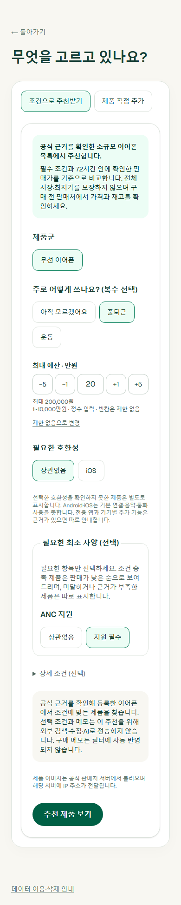
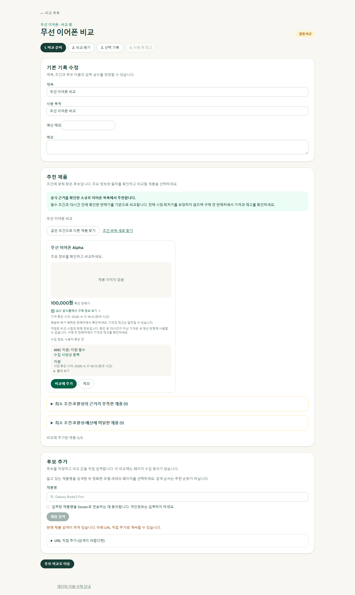
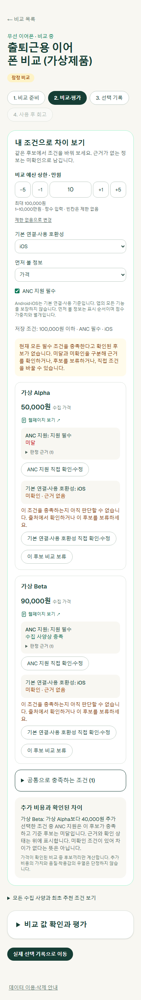
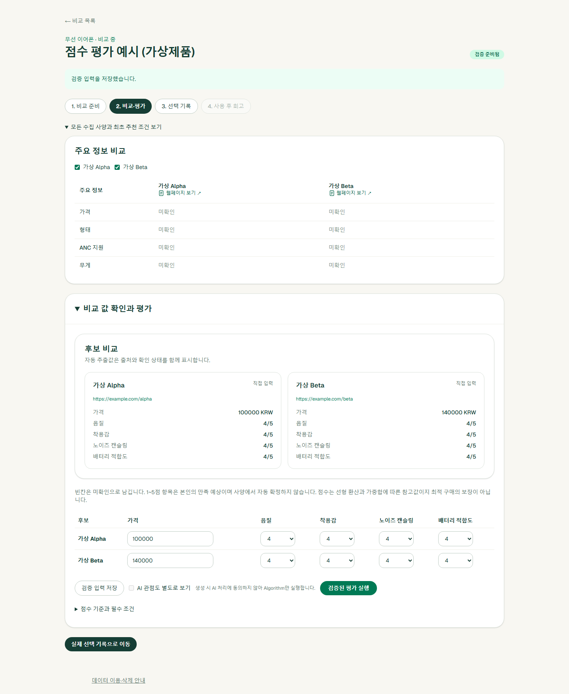
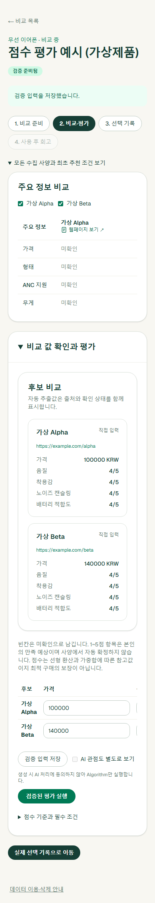
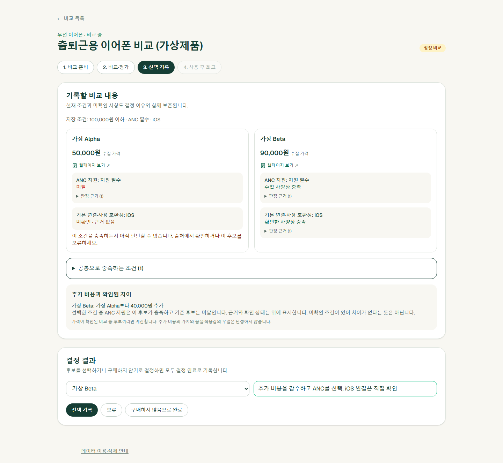
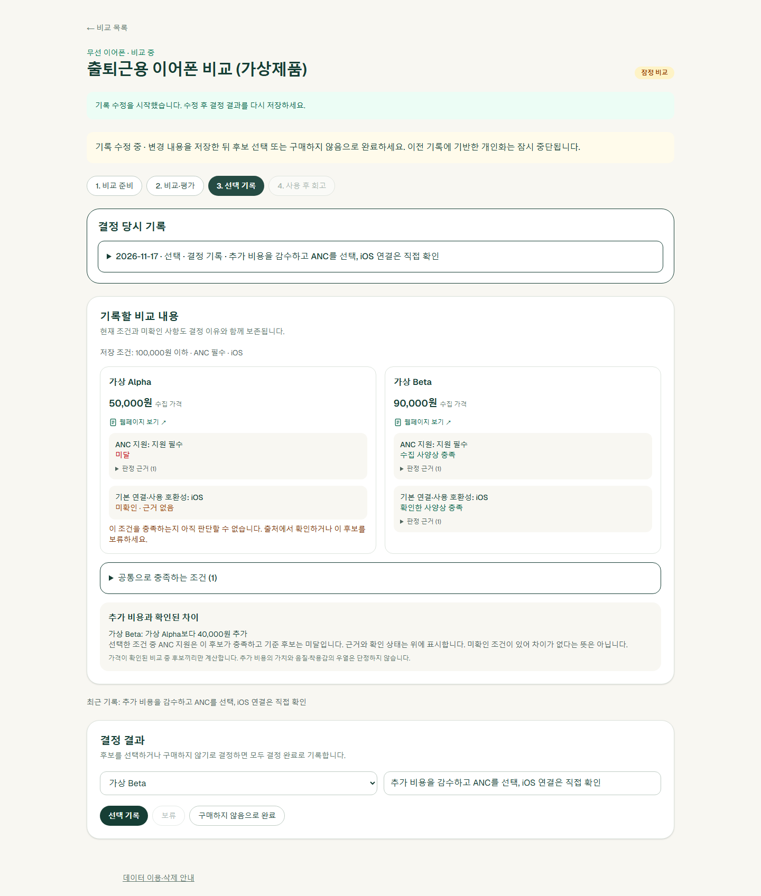
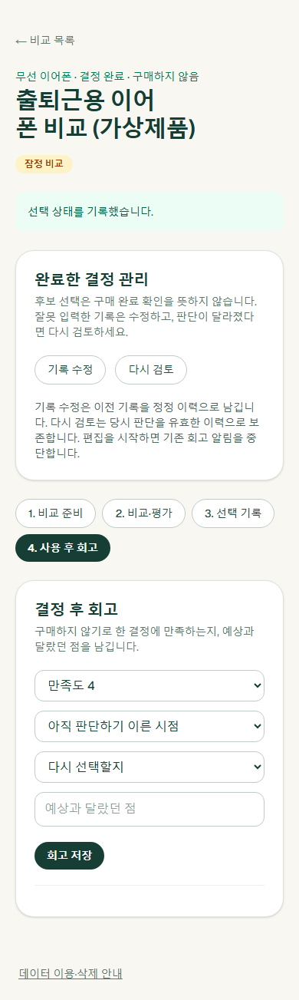
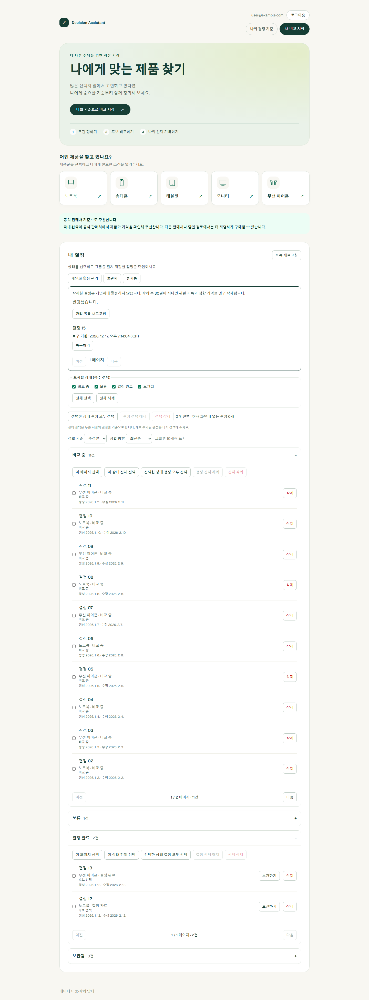
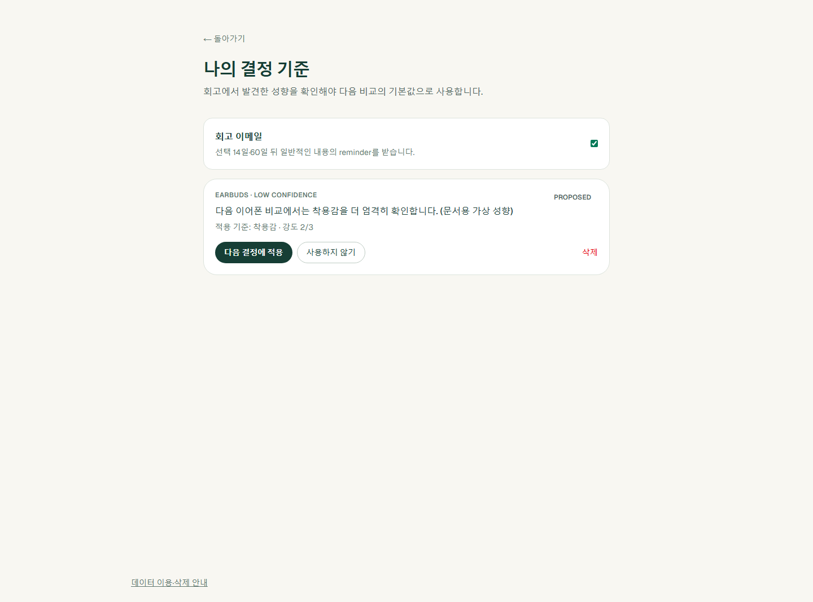

# UI 화면 모음

[도메인 개요](../domain.md) · [실행 구조](../architecture.md)

개발자가 사용자 흐름과 도메인 상태를 함께 살펴보는 대표 화면 모음이다. 각 이미지 아래의 모바일 화면도 펼쳐 볼 수 있다. 과거 검증 자료는 [evaluations](../evaluations/)에 그대로 보존한다.

## 촬영 기준과 한계

- 촬영일: 2026-11-17. 애플리케이션 기준 commit: `62a58b19ae5228d0fc5e14e61c775c532f879c73`. 이번 변경은 문서와 촬영 도구만 추가한다.
- 환경: 현재 worktree의 Next.js 개발 서버 + 기존 Playwright mock backend + Chromium, ko-KR, Asia/Seoul.
- 데이터: 가상 Alpha/Beta 등의 E2E fixture다. 성향·email 설정 API만 촬영 스크립트의 고정 응답을 사용한다. 실제 사용자·개발 DB·외부 provider·상품 이미지를 사용하지 않는다.
- 목록 화면의 제품군 navigation은 서버에서 읽는 기존 mock capabilities에 따라 5개 제품군을 표시한다. 실제 기본 카탈로그의 추천 범위는 이어폰이며, 이 모음이 다른 제품군의 카탈로그 지원을 뜻하지 않는다.
- 크기: 데스크톱 1440×1000, 모바일 390×844 viewport의 전체 페이지다. 이미지는 viewport보다 길 수 있다. Next.js 개발 도구 overlay만 숨긴다.
- 자료의 범위: 실제 frontend의 배치·문구·조작 흐름을 보여 준다. 실제 판매가·판정 정확성·메일 발송·Auth0 로그인·운영 DB 동작을 검증하지 않는다. 재검토의 별도 진행 화면, 실패·충돌의 모든 조합은 포함하지 않으며 관련 E2E를 참고한다.
- 정확한 실행 시각·기준 commit·파일별 경로·상태·viewport는 [capture-manifest.json](capture-manifest.json)에 기록한다. 이미지 변경 시 이 문서와 manifest를 함께 갱신한다.

## 화면 순서

| 과정 | 화면 | 관련 도메인 |
|---|---|---|
| 1 | [조건 선택](#화면-1) | [탐색·근거](../domains/discovery-evidence.md) |
| 2 | [추천 후보](#화면-2) | [카탈로그](../domains/catalog.md) |
| 3 | [후보 조건 비교](#화면-3) | [결정·비교](../domains/decision-comparison.md) |
| 4 | [직접 확인](#화면-4) | [결정·비교](../domains/decision-comparison.md) |
| 5 | [선택적 점수 평가 입력](#화면-5) | [평가](../domains/evaluation.md) |
| 6 | [선택적 점수 평가 결과](#화면-6) | [평가](../domains/evaluation.md) |
| 7 | [결정 결과 기록](#화면-7) | [결정·비교](../domains/decision-comparison.md) |
| 8 | [사용 후 회고](#화면-8) | [회고·개인화](../domains/outcome-personalization.md) |
| 9 | [완료 기록 정정](#화면-9) | [결정·비교](../domains/decision-comparison.md) |
| 10 | [구매하지 않음으로 완료](#화면-10) | [회고·개인화](../domains/outcome-personalization.md) |
| 11 | [결정 목록](#화면-11) | [결정·비교](../domains/decision-comparison.md) |
| 12 | [보관함](#화면-12) | [결정·비교](../domains/decision-comparison.md) |
| 13 | [휴지통](#화면-13) | [결정·비교](../domains/decision-comparison.md) |
| 14 | [성향 확인·알림 설정](#화면-14) | [회고·개인화](../domains/outcome-personalization.md) |

<a id="화면-1"></a>

## 1. 조건 선택

진입: `/decisions/new`. 기본 카탈로그에서 용도·예산·ANC를 선택한다. 검색·수집·AI 동의 없이 시작한다.


<details>
<summary>모바일 화면 보기</summary>



</details>

<a id="화면-2"></a>

## 2. 추천 후보

진입: `/decisions/{id} · 추천`. 아직 Option이 아닌 제안이다. 충족·미달·미확인과 가격·사양 확인 시각을 구분한다.



<details>
<summary>모바일 화면 보기</summary>


</details>

<a id="화면-3"></a>

## 3. 후보 조건 비교

진입: `/decisions/{id} · 2. 비교·평가`. 현재 비교 조건을 바꿔도 후보와 최초 추천 조건은 유지한다. 미확인은 기능 없음이 아니다.


<details>
<summary>모바일 화면 보기</summary>



</details>

<a id="화면-4"></a>

## 4. 직접 확인

진입: `/decisions/{id} · 기능 확인 입력`. 직접 확인은 해당 후보·기능·플랫폼에만 적용하며 수집 근거와 구분한다.


<details>
<summary>모바일 화면 보기</summary>


</details>

<a id="화면-5"></a>

## 5. 선택적 점수 평가 입력

진입: `/decisions/{id} · 비교 값 확인과 평가`. 가격과 예상 만족도 입력은 표시 사양과 별개다. 평가 없이 실제 선택을 기록할 수도 있다.



<details>
<summary>모바일 화면 보기</summary>



</details>

<a id="화면-6"></a>

## 6. 선택적 점수 평가 결과

진입: `/decisions/{id} · 평가 결과`. mock 응답을 표시한 UI다. 점수의 정확성·실제 알고리즘·외부 AI 품질을 검증한 자료가 아니다.


<details>
<summary>모바일 화면 보기</summary>


</details>

<a id="화면-7"></a>

## 7. 결정 결과 기록

진입: `/decisions/{id} · 3. 선택 기록`. 후보 선택·보류·구매하지 않음과 이유를 기록하고 당시 비교 근거를 고정한다.



<details>
<summary>모바일 화면 보기</summary>


</details>

<a id="화면-8"></a>

## 8. 사용 후 회고

진입: `/decisions/{id} · 회고`. 회고는 대상 완료 기록에 연결한다. 가상 회고 입력·저장 화면이며 실제 사용 결과가 아니다.


<details>
<summary>모바일 화면 보기</summary>


</details>

<a id="화면-9"></a>

## 9. 완료 기록 정정

진입: `/decisions/{id} · 기록 수정 중`. 원본 고정본을 보존하고 정정본을 추가한다. 정정 중 보류는 비활성이다. 재검토는 과거 판단을 유효하게 보존하는 별도 경로다.



<details>
<summary>모바일 화면 보기</summary>


</details>

<a id="화면-10"></a>

## 10. 구매하지 않음으로 완료

진입: `/decisions/{id} · 결정 후 회고`. 구매하지 않음도 완료다. 제품 사용 회고와 달리 결정에 대한 수동 회고를 제공한다.


<details>
<summary>모바일 화면 보기</summary>



</details>

<a id="화면-11"></a>

## 11. 결정 목록

진입: `/?open=DRAFT,CHOSEN`. 소유자 범위의 진행·완료 그룹, 필터·정렬·선택을 확인한다.


<details>
<summary>모바일 화면 보기</summary>


</details>

<a id="화면-12"></a>

## 12. 보관함

진입: `/ · 보관함`. 완료 상태를 유지하며 목록을 정리한다. 보관과 개인화 활용 중단은 별개다.


<details>
<summary>모바일 화면 보기</summary>


</details>

<a id="화면-13"></a>

## 13. 휴지통

진입: `/ · 휴지통`. 복구 기한과 복구 동작을 확인한다. 삭제 중에는 개인화·후속 작업에서 제외된다.



<details>
<summary>모바일 화면 보기</summary>


</details>

<a id="화면-14"></a>

## 14. 성향 확인·알림 설정

진입: `/preferences`. PROPOSED 성향을 명시적으로 확인하고 회고 email 수신 여부를 설정한다. 성향 API는 촬영용 고정 응답이다.



<details>
<summary>모바일 화면 보기</summary>


</details>

## 재촬영과 유지 방법

현재 branch의 의존성을 설치한 뒤 저장소 루트에서 실행한다. 3100·18080 포트가 비어 있어야 하며, 기존 서버를 재사용하지 않는다. 일반 E2E 실행은 문서 이미지를 덮어쓰지 않는다.

```powershell
npm.cmd --prefix frontend ci
npm.cmd --prefix frontend exec -- playwright install chromium
npm.cmd --prefix frontend run test:e2e -- --config playwright.docs.config.ts
```

촬영 구성은 [playwright.docs.config.ts](../../frontend/playwright.docs.config.ts), 시나리오·fixture·출력 metadata는 [ui-gallery.capture.ts](../../frontend/e2e/ui-gallery.capture.ts)에 있다. fixture 변경이 도메인 정책 변경으로 오해되지 않도록 화면 상태와 한계를 함께 기록한다.

촬영 성공 후 이미지를 직접 열어 로딩 중 화면·오류·잘림·불필요한 개인정보가 없는지 확인한다. [촬영 준비 상태 진단](../troubleshooting/ui-gallery-capture.md)을 참고한다. UI 동작을 바꾸는 PR에서는 영향받는 장면과 촬영일·기준 commit을 갱신한다. 무관한 과거 검증 이미지는 덮어쓰지 않는다. 이 모음은 픽셀 단위 회귀 검사의 baseline이 아니다.
